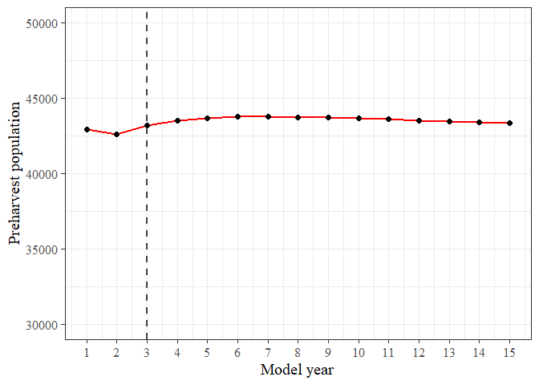

<!-- README.md is generated from README.Rmd. Please edit that file -->

# *AcCountPop*

<!-- badges: start -->

<!-- badges: end -->

The goal of *AcCountPop* is to provide an accessible method to calculate
the dynamics of wild game populations using data that is readily
available for wild game agencies. These models are deterministic but
provide enough realism to make informed harvest-management decisions.

## Installation

You can install the development version of *AcCountPop* like so:

``` r
remotes::install_github("huh0001/AcCountPop")
```

## Example

This is a basic example which shows you how to solve a common problem:

``` r
library(AcCountPop)
library(ggplot2)
library(gt)

## Baseline Scenario Example
results <- AcCountDeer(preharvest_pop = 40000,
             doe_ratio = 130,
             adult_prop = 0.51,
             y1_prop = 0.04,
             yearling_prop = 0.2,
             fawn_prop = 0.25,
             adult_fawn_rate = 1.6,
             yearling_fawn_rate = 0.2,
             antlered_harvest = 2305,
             antlerless_harvest = 2174,
             prop_ymale_in_antlered_harvest = 0.11,
             prop_yfemale_in_antlerless_harvest = 0.18,
             prop_fawn_in_antlerless_harvest = 0.12,
             birth_month = 6,
             season_open = 10,
             season_duration = 4,
             adult_male_nhm = 0.24,
             adult_female_nhm = 0.26,
             yearling_male_nhm = 0.255,
             yearling_female_nhm = 0.18,
             fawn_male_nhm = 0.46,
             fawn_female_nhm = 0.4523,
             six_month_fawn_nhm = 0.45)

#Postharvest Population
gt(results[,c(1:10)])
```

<div id="iubxgpnfsz" style="padding-left:0px;padding-right:0px;padding-top:10px;padding-bottom:10px;overflow-x:auto;overflow-y:auto;width:auto;height:auto;">
<style>#iubxgpnfsz table {
  font-family: system-ui, 'Segoe UI', Roboto, Helvetica, Arial, sans-serif, 'Apple Color Emoji', 'Segoe UI Emoji', 'Segoe UI Symbol', 'Noto Color Emoji';
  -webkit-font-smoothing: antialiased;
  -moz-osx-font-smoothing: grayscale;
}
&#10;#iubxgpnfsz thead, #iubxgpnfsz tbody, #iubxgpnfsz tfoot, #iubxgpnfsz tr, #iubxgpnfsz td, #iubxgpnfsz th {
  border-style: none;
}
&#10;#iubxgpnfsz p {
  margin: 0;
  padding: 0;
}
&#10;#iubxgpnfsz .gt_table {
  display: table;
  border-collapse: collapse;
  line-height: normal;
  margin-left: auto;
  margin-right: auto;
  color: #333333;
  font-size: 16px;
  font-weight: normal;
  font-style: normal;
  background-color: #FFFFFF;
  width: auto;
  border-top-style: solid;
  border-top-width: 2px;
  border-top-color: #A8A8A8;
  border-right-style: none;
  border-right-width: 2px;
  border-right-color: #D3D3D3;
  border-bottom-style: solid;
  border-bottom-width: 2px;
  border-bottom-color: #A8A8A8;
  border-left-style: none;
  border-left-width: 2px;
  border-left-color: #D3D3D3;
}
&#10;#iubxgpnfsz .gt_caption {
  padding-top: 4px;
  padding-bottom: 4px;
}
&#10;#iubxgpnfsz .gt_title {
  color: #333333;
  font-size: 125%;
  font-weight: initial;
  padding-top: 4px;
  padding-bottom: 4px;
  padding-left: 5px;
  padding-right: 5px;
  border-bottom-color: #FFFFFF;
  border-bottom-width: 0;
}
&#10;#iubxgpnfsz .gt_subtitle {
  color: #333333;
  font-size: 85%;
  font-weight: initial;
  padding-top: 3px;
  padding-bottom: 5px;
  padding-left: 5px;
  padding-right: 5px;
  border-top-color: #FFFFFF;
  border-top-width: 0;
}
&#10;#iubxgpnfsz .gt_heading {
  background-color: #FFFFFF;
  text-align: center;
  border-bottom-color: #FFFFFF;
  border-left-style: none;
  border-left-width: 1px;
  border-left-color: #D3D3D3;
  border-right-style: none;
  border-right-width: 1px;
  border-right-color: #D3D3D3;
}
&#10;#iubxgpnfsz .gt_bottom_border {
  border-bottom-style: solid;
  border-bottom-width: 2px;
  border-bottom-color: #D3D3D3;
}
&#10;#iubxgpnfsz .gt_col_headings {
  border-top-style: solid;
  border-top-width: 2px;
  border-top-color: #D3D3D3;
  border-bottom-style: solid;
  border-bottom-width: 2px;
  border-bottom-color: #D3D3D3;
  border-left-style: none;
  border-left-width: 1px;
  border-left-color: #D3D3D3;
  border-right-style: none;
  border-right-width: 1px;
  border-right-color: #D3D3D3;
}
&#10;#iubxgpnfsz .gt_col_heading {
  color: #333333;
  background-color: #FFFFFF;
  font-size: 100%;
  font-weight: normal;
  text-transform: inherit;
  border-left-style: none;
  border-left-width: 1px;
  border-left-color: #D3D3D3;
  border-right-style: none;
  border-right-width: 1px;
  border-right-color: #D3D3D3;
  vertical-align: bottom;
  padding-top: 5px;
  padding-bottom: 6px;
  padding-left: 5px;
  padding-right: 5px;
  overflow-x: hidden;
}
&#10;#iubxgpnfsz .gt_column_spanner_outer {
  color: #333333;
  background-color: #FFFFFF;
  font-size: 100%;
  font-weight: normal;
  text-transform: inherit;
  padding-top: 0;
  padding-bottom: 0;
  padding-left: 4px;
  padding-right: 4px;
}
&#10;#iubxgpnfsz .gt_column_spanner_outer:first-child {
  padding-left: 0;
}
&#10;#iubxgpnfsz .gt_column_spanner_outer:last-child {
  padding-right: 0;
}
&#10;#iubxgpnfsz .gt_column_spanner {
  border-bottom-style: solid;
  border-bottom-width: 2px;
  border-bottom-color: #D3D3D3;
  vertical-align: bottom;
  padding-top: 5px;
  padding-bottom: 5px;
  overflow-x: hidden;
  display: inline-block;
  width: 100%;
}
&#10;#iubxgpnfsz .gt_spanner_row {
  border-bottom-style: hidden;
}
&#10;#iubxgpnfsz .gt_group_heading {
  padding-top: 8px;
  padding-bottom: 8px;
  padding-left: 5px;
  padding-right: 5px;
  color: #333333;
  background-color: #FFFFFF;
  font-size: 100%;
  font-weight: initial;
  text-transform: inherit;
  border-top-style: solid;
  border-top-width: 2px;
  border-top-color: #D3D3D3;
  border-bottom-style: solid;
  border-bottom-width: 2px;
  border-bottom-color: #D3D3D3;
  border-left-style: none;
  border-left-width: 1px;
  border-left-color: #D3D3D3;
  border-right-style: none;
  border-right-width: 1px;
  border-right-color: #D3D3D3;
  vertical-align: middle;
  text-align: left;
}
&#10;#iubxgpnfsz .gt_empty_group_heading {
  padding: 0.5px;
  color: #333333;
  background-color: #FFFFFF;
  font-size: 100%;
  font-weight: initial;
  border-top-style: solid;
  border-top-width: 2px;
  border-top-color: #D3D3D3;
  border-bottom-style: solid;
  border-bottom-width: 2px;
  border-bottom-color: #D3D3D3;
  vertical-align: middle;
}
&#10;#iubxgpnfsz .gt_from_md > :first-child {
  margin-top: 0;
}
&#10;#iubxgpnfsz .gt_from_md > :last-child {
  margin-bottom: 0;
}
&#10;#iubxgpnfsz .gt_row {
  padding-top: 8px;
  padding-bottom: 8px;
  padding-left: 5px;
  padding-right: 5px;
  margin: 10px;
  border-top-style: solid;
  border-top-width: 1px;
  border-top-color: #D3D3D3;
  border-left-style: none;
  border-left-width: 1px;
  border-left-color: #D3D3D3;
  border-right-style: none;
  border-right-width: 1px;
  border-right-color: #D3D3D3;
  vertical-align: middle;
  overflow-x: hidden;
}
&#10;#iubxgpnfsz .gt_stub {
  color: #333333;
  background-color: #FFFFFF;
  font-size: 100%;
  font-weight: initial;
  text-transform: inherit;
  border-right-style: solid;
  border-right-width: 2px;
  border-right-color: #D3D3D3;
  padding-left: 5px;
  padding-right: 5px;
}
&#10;#iubxgpnfsz .gt_stub_row_group {
  color: #333333;
  background-color: #FFFFFF;
  font-size: 100%;
  font-weight: initial;
  text-transform: inherit;
  border-right-style: solid;
  border-right-width: 2px;
  border-right-color: #D3D3D3;
  padding-left: 5px;
  padding-right: 5px;
  vertical-align: top;
}
&#10;#iubxgpnfsz .gt_row_group_first td {
  border-top-width: 2px;
}
&#10;#iubxgpnfsz .gt_row_group_first th {
  border-top-width: 2px;
}
&#10;#iubxgpnfsz .gt_summary_row {
  color: #333333;
  background-color: #FFFFFF;
  text-transform: inherit;
  padding-top: 8px;
  padding-bottom: 8px;
  padding-left: 5px;
  padding-right: 5px;
}
&#10;#iubxgpnfsz .gt_first_summary_row {
  border-top-style: solid;
  border-top-color: #D3D3D3;
}
&#10;#iubxgpnfsz .gt_first_summary_row.thick {
  border-top-width: 2px;
}
&#10;#iubxgpnfsz .gt_last_summary_row {
  padding-top: 8px;
  padding-bottom: 8px;
  padding-left: 5px;
  padding-right: 5px;
  border-bottom-style: solid;
  border-bottom-width: 2px;
  border-bottom-color: #D3D3D3;
}
&#10;#iubxgpnfsz .gt_grand_summary_row {
  color: #333333;
  background-color: #FFFFFF;
  text-transform: inherit;
  padding-top: 8px;
  padding-bottom: 8px;
  padding-left: 5px;
  padding-right: 5px;
}
&#10;#iubxgpnfsz .gt_first_grand_summary_row {
  padding-top: 8px;
  padding-bottom: 8px;
  padding-left: 5px;
  padding-right: 5px;
  border-top-style: double;
  border-top-width: 6px;
  border-top-color: #D3D3D3;
}
&#10;#iubxgpnfsz .gt_last_grand_summary_row_top {
  padding-top: 8px;
  padding-bottom: 8px;
  padding-left: 5px;
  padding-right: 5px;
  border-bottom-style: double;
  border-bottom-width: 6px;
  border-bottom-color: #D3D3D3;
}
&#10;#iubxgpnfsz .gt_striped {
  background-color: rgba(128, 128, 128, 0.05);
}
&#10;#iubxgpnfsz .gt_table_body {
  border-top-style: solid;
  border-top-width: 2px;
  border-top-color: #D3D3D3;
  border-bottom-style: solid;
  border-bottom-width: 2px;
  border-bottom-color: #D3D3D3;
}
&#10;#iubxgpnfsz .gt_footnotes {
  color: #333333;
  background-color: #FFFFFF;
  border-bottom-style: none;
  border-bottom-width: 2px;
  border-bottom-color: #D3D3D3;
  border-left-style: none;
  border-left-width: 2px;
  border-left-color: #D3D3D3;
  border-right-style: none;
  border-right-width: 2px;
  border-right-color: #D3D3D3;
}
&#10;#iubxgpnfsz .gt_footnote {
  margin: 0px;
  font-size: 90%;
  padding-top: 4px;
  padding-bottom: 4px;
  padding-left: 5px;
  padding-right: 5px;
}
&#10;#iubxgpnfsz .gt_sourcenotes {
  color: #333333;
  background-color: #FFFFFF;
  border-bottom-style: none;
  border-bottom-width: 2px;
  border-bottom-color: #D3D3D3;
  border-left-style: none;
  border-left-width: 2px;
  border-left-color: #D3D3D3;
  border-right-style: none;
  border-right-width: 2px;
  border-right-color: #D3D3D3;
}
&#10;#iubxgpnfsz .gt_sourcenote {
  font-size: 90%;
  padding-top: 4px;
  padding-bottom: 4px;
  padding-left: 5px;
  padding-right: 5px;
}
&#10;#iubxgpnfsz .gt_left {
  text-align: left;
}
&#10;#iubxgpnfsz .gt_center {
  text-align: center;
}
&#10;#iubxgpnfsz .gt_right {
  text-align: right;
  font-variant-numeric: tabular-nums;
}
&#10;#iubxgpnfsz .gt_font_normal {
  font-weight: normal;
}
&#10;#iubxgpnfsz .gt_font_bold {
  font-weight: bold;
}
&#10;#iubxgpnfsz .gt_font_italic {
  font-style: italic;
}
&#10;#iubxgpnfsz .gt_super {
  font-size: 65%;
}
&#10;#iubxgpnfsz .gt_footnote_marks {
  font-size: 75%;
  vertical-align: 0.4em;
  position: initial;
}
&#10;#iubxgpnfsz .gt_asterisk {
  font-size: 100%;
  vertical-align: 0;
}
&#10;#iubxgpnfsz .gt_indent_1 {
  text-indent: 5px;
}
&#10;#iubxgpnfsz .gt_indent_2 {
  text-indent: 10px;
}
&#10;#iubxgpnfsz .gt_indent_3 {
  text-indent: 15px;
}
&#10;#iubxgpnfsz .gt_indent_4 {
  text-indent: 20px;
}
&#10;#iubxgpnfsz .gt_indent_5 {
  text-indent: 25px;
}
&#10;#iubxgpnfsz .katex-display {
  display: inline-flex !important;
  margin-bottom: 0.75em !important;
}
&#10;#iubxgpnfsz div.Reactable > div.rt-table > div.rt-thead > div.rt-tr.rt-tr-group-header > div.rt-th-group:after {
  height: 0px !important;
}
</style>
<table class="gt_table" data-quarto-disable-processing="false" data-quarto-bootstrap="false">
  <thead>
    <tr class="gt_col_headings">
      <th class="gt_col_heading gt_columns_bottom_border gt_right" rowspan="1" colspan="1" scope="col" id="ModelYear">ModelYear</th>
      <th class="gt_col_heading gt_columns_bottom_border gt_right" rowspan="1" colspan="1" scope="col" id="N_adult_male_posth">N_adult_male_posth</th>
      <th class="gt_col_heading gt_columns_bottom_border gt_right" rowspan="1" colspan="1" scope="col" id="N_adult_female_posth">N_adult_female_posth</th>
      <th class="gt_col_heading gt_columns_bottom_border gt_right" rowspan="1" colspan="1" scope="col" id="N_y1_male_posth">N_y1_male_posth</th>
      <th class="gt_col_heading gt_columns_bottom_border gt_right" rowspan="1" colspan="1" scope="col" id="N_y1_female_posth">N_y1_female_posth</th>
      <th class="gt_col_heading gt_columns_bottom_border gt_right" rowspan="1" colspan="1" scope="col" id="N_yearling_male_posth">N_yearling_male_posth</th>
      <th class="gt_col_heading gt_columns_bottom_border gt_right" rowspan="1" colspan="1" scope="col" id="N_yearling_female_posth">N_yearling_female_posth</th>
      <th class="gt_col_heading gt_columns_bottom_border gt_right" rowspan="1" colspan="1" scope="col" id="N_fawn_male_posth">N_fawn_male_posth</th>
      <th class="gt_col_heading gt_columns_bottom_border gt_right" rowspan="1" colspan="1" scope="col" id="N_fawn_female_posth">N_fawn_female_posth</th>
      <th class="gt_col_heading gt_columns_bottom_border gt_right" rowspan="1" colspan="1" scope="col" id="N_postharvest">N_postharvest</th>
    </tr>
  </thead>
  <tbody class="gt_table_body">
    <tr><td headers="ModelYear" class="gt_row gt_right">1</td>
<td headers="N_adult_male_posth" class="gt_row gt_right">6244</td>
<td headers="N_adult_female_posth" class="gt_row gt_right">9150</td>
<td headers="N_y1_male_posth" class="gt_row gt_right">553</td>
<td headers="N_y1_female_posth" class="gt_row gt_right">767</td>
<td headers="N_yearling_male_posth" class="gt_row gt_right">2900</td>
<td headers="N_yearling_female_posth" class="gt_row gt_right">3884</td>
<td headers="N_fawn_male_posth" class="gt_row gt_right">3397</td>
<td headers="N_fawn_female_posth" class="gt_row gt_right">4570</td>
<td headers="N_postharvest" class="gt_row gt_right">31465</td></tr>
    <tr><td headers="ModelYear" class="gt_row gt_right">2</td>
<td headers="N_adult_male_posth" class="gt_row gt_right">4030</td>
<td headers="N_adult_female_posth" class="gt_row gt_right">6385</td>
<td headers="N_y1_male_posth" class="gt_row gt_right">1923</td>
<td headers="N_y1_female_posth" class="gt_row gt_right">2790</td>
<td headers="N_yearling_male_posth" class="gt_row gt_right">2059</td>
<td headers="N_yearling_female_posth" class="gt_row gt_right">2882</td>
<td headers="N_fawn_male_posth" class="gt_row gt_right">6949</td>
<td headers="N_fawn_female_posth" class="gt_row gt_right">7054</td>
<td headers="N_postharvest" class="gt_row gt_right">34072</td></tr>
    <tr><td headers="ModelYear" class="gt_row gt_right">3</td>
<td headers="N_adult_male_posth" class="gt_row gt_right">3529</td>
<td headers="N_adult_female_posth" class="gt_row gt_right">5907</td>
<td headers="N_y1_male_posth" class="gt_row gt_right">1365</td>
<td headers="N_y1_female_posth" class="gt_row gt_right">2070</td>
<td headers="N_yearling_male_posth" class="gt_row gt_right">4211</td>
<td headers="N_yearling_female_posth" class="gt_row gt_right">4449</td>
<td headers="N_fawn_male_posth" class="gt_row gt_right">6221</td>
<td headers="N_fawn_female_posth" class="gt_row gt_right">6315</td>
<td headers="N_postharvest" class="gt_row gt_right">34067</td></tr>
    <tr><td headers="ModelYear" class="gt_row gt_right">4</td>
<td headers="N_adult_male_posth" class="gt_row gt_right">2901</td>
<td headers="N_adult_female_posth" class="gt_row gt_right">5135</td>
<td headers="N_y1_male_posth" class="gt_row gt_right">2793</td>
<td headers="N_y1_female_posth" class="gt_row gt_right">3196</td>
<td headers="N_yearling_male_posth" class="gt_row gt_right">3769</td>
<td headers="N_yearling_female_posth" class="gt_row gt_right">3983</td>
<td headers="N_fawn_male_posth" class="gt_row gt_right">6392</td>
<td headers="N_fawn_female_posth" class="gt_row gt_right">6488</td>
<td headers="N_postharvest" class="gt_row gt_right">34657</td></tr>
    <tr><td headers="ModelYear" class="gt_row gt_right">5</td>
<td headers="N_adult_male_posth" class="gt_row gt_right">3375</td>
<td headers="N_adult_female_posth" class="gt_row gt_right">5364</td>
<td headers="N_y1_male_posth" class="gt_row gt_right">2500</td>
<td headers="N_y1_female_posth" class="gt_row gt_right">2861</td>
<td headers="N_yearling_male_posth" class="gt_row gt_right">3873</td>
<td headers="N_yearling_female_posth" class="gt_row gt_right">4093</td>
<td headers="N_fawn_male_posth" class="gt_row gt_right">6338</td>
<td headers="N_fawn_female_posth" class="gt_row gt_right">6434</td>
<td headers="N_postharvest" class="gt_row gt_right">34838</td></tr>
    <tr><td headers="ModelYear" class="gt_row gt_right">6</td>
<td headers="N_adult_male_posth" class="gt_row gt_right">3483</td>
<td headers="N_adult_female_posth" class="gt_row gt_right">5295</td>
<td headers="N_y1_male_posth" class="gt_row gt_right">2569</td>
<td headers="N_y1_female_posth" class="gt_row gt_right">2940</td>
<td headers="N_yearling_male_posth" class="gt_row gt_right">3840</td>
<td headers="N_yearling_female_posth" class="gt_row gt_right">4059</td>
<td headers="N_fawn_male_posth" class="gt_row gt_right">6339</td>
<td headers="N_fawn_female_posth" class="gt_row gt_right">6435</td>
<td headers="N_postharvest" class="gt_row gt_right">34960</td></tr>
    <tr><td headers="ModelYear" class="gt_row gt_right">7</td>
<td headers="N_adult_male_posth" class="gt_row gt_right">3588</td>
<td headers="N_adult_female_posth" class="gt_row gt_right">5301</td>
<td headers="N_y1_male_posth" class="gt_row gt_right">2547</td>
<td headers="N_y1_female_posth" class="gt_row gt_right">2916</td>
<td headers="N_yearling_male_posth" class="gt_row gt_right">3841</td>
<td headers="N_yearling_female_posth" class="gt_row gt_right">4059</td>
<td headers="N_fawn_male_posth" class="gt_row gt_right">6328</td>
<td headers="N_fawn_female_posth" class="gt_row gt_right">6423</td>
<td headers="N_postharvest" class="gt_row gt_right">35003</td></tr>
    <tr><td headers="ModelYear" class="gt_row gt_right">8</td>
<td headers="N_adult_male_posth" class="gt_row gt_right">3637</td>
<td headers="N_adult_female_posth" class="gt_row gt_right">5290</td>
<td headers="N_y1_male_posth" class="gt_row gt_right">2548</td>
<td headers="N_y1_female_posth" class="gt_row gt_right">2916</td>
<td headers="N_yearling_male_posth" class="gt_row gt_right">3834</td>
<td headers="N_yearling_female_posth" class="gt_row gt_right">4051</td>
<td headers="N_fawn_male_posth" class="gt_row gt_right">6318</td>
<td headers="N_fawn_female_posth" class="gt_row gt_right">6414</td>
<td headers="N_postharvest" class="gt_row gt_right">35008</td></tr>
    <tr><td headers="ModelYear" class="gt_row gt_right">9</td>
<td headers="N_adult_male_posth" class="gt_row gt_right">3667</td>
<td headers="N_adult_female_posth" class="gt_row gt_right">5283</td>
<td headers="N_y1_male_posth" class="gt_row gt_right">2543</td>
<td headers="N_y1_female_posth" class="gt_row gt_right">2911</td>
<td headers="N_yearling_male_posth" class="gt_row gt_right">3828</td>
<td headers="N_yearling_female_posth" class="gt_row gt_right">4045</td>
<td headers="N_fawn_male_posth" class="gt_row gt_right">6309</td>
<td headers="N_fawn_female_posth" class="gt_row gt_right">6404</td>
<td headers="N_postharvest" class="gt_row gt_right">34990</td></tr>
    <tr><td headers="ModelYear" class="gt_row gt_right">10</td>
<td headers="N_adult_male_posth" class="gt_row gt_right">3681</td>
<td headers="N_adult_female_posth" class="gt_row gt_right">5276</td>
<td headers="N_y1_male_posth" class="gt_row gt_right">2539</td>
<td headers="N_y1_female_posth" class="gt_row gt_right">2905</td>
<td headers="N_yearling_male_posth" class="gt_row gt_right">3823</td>
<td headers="N_yearling_female_posth" class="gt_row gt_right">4039</td>
<td headers="N_fawn_male_posth" class="gt_row gt_right">6299</td>
<td headers="N_fawn_female_posth" class="gt_row gt_right">6394</td>
<td headers="N_postharvest" class="gt_row gt_right">34956</td></tr>
    <tr><td headers="ModelYear" class="gt_row gt_right">11</td>
<td headers="N_adult_male_posth" class="gt_row gt_right">3687</td>
<td headers="N_adult_female_posth" class="gt_row gt_right">5267</td>
<td headers="N_y1_male_posth" class="gt_row gt_right">2536</td>
<td headers="N_y1_female_posth" class="gt_row gt_right">2900</td>
<td headers="N_yearling_male_posth" class="gt_row gt_right">3817</td>
<td headers="N_yearling_female_posth" class="gt_row gt_right">4032</td>
<td headers="N_fawn_male_posth" class="gt_row gt_right">6289</td>
<td headers="N_fawn_female_posth" class="gt_row gt_right">6384</td>
<td headers="N_postharvest" class="gt_row gt_right">34912</td></tr>
    <tr><td headers="ModelYear" class="gt_row gt_right">12</td>
<td headers="N_adult_male_posth" class="gt_row gt_right">3689</td>
<td headers="N_adult_female_posth" class="gt_row gt_right">5258</td>
<td headers="N_y1_male_posth" class="gt_row gt_right">2531</td>
<td headers="N_y1_female_posth" class="gt_row gt_right">2896</td>
<td headers="N_yearling_male_posth" class="gt_row gt_right">3811</td>
<td headers="N_yearling_female_posth" class="gt_row gt_right">4027</td>
<td headers="N_fawn_male_posth" class="gt_row gt_right">6279</td>
<td headers="N_fawn_female_posth" class="gt_row gt_right">6374</td>
<td headers="N_postharvest" class="gt_row gt_right">34865</td></tr>
    <tr><td headers="ModelYear" class="gt_row gt_right">13</td>
<td headers="N_adult_male_posth" class="gt_row gt_right">3687</td>
<td headers="N_adult_female_posth" class="gt_row gt_right">5250</td>
<td headers="N_y1_male_posth" class="gt_row gt_right">2527</td>
<td headers="N_y1_female_posth" class="gt_row gt_right">2892</td>
<td headers="N_yearling_male_posth" class="gt_row gt_right">3804</td>
<td headers="N_yearling_female_posth" class="gt_row gt_right">4020</td>
<td headers="N_fawn_male_posth" class="gt_row gt_right">6269</td>
<td headers="N_fawn_female_posth" class="gt_row gt_right">6364</td>
<td headers="N_postharvest" class="gt_row gt_right">34813</td></tr>
    <tr><td headers="ModelYear" class="gt_row gt_right">14</td>
<td headers="N_adult_male_posth" class="gt_row gt_right">3684</td>
<td headers="N_adult_female_posth" class="gt_row gt_right">5242</td>
<td headers="N_y1_male_posth" class="gt_row gt_right">2523</td>
<td headers="N_y1_female_posth" class="gt_row gt_right">2888</td>
<td headers="N_yearling_male_posth" class="gt_row gt_right">3798</td>
<td headers="N_yearling_female_posth" class="gt_row gt_right">4013</td>
<td headers="N_fawn_male_posth" class="gt_row gt_right">6260</td>
<td headers="N_fawn_female_posth" class="gt_row gt_right">6354</td>
<td headers="N_postharvest" class="gt_row gt_right">34762</td></tr>
    <tr><td headers="ModelYear" class="gt_row gt_right">15</td>
<td headers="N_adult_male_posth" class="gt_row gt_right">3679</td>
<td headers="N_adult_female_posth" class="gt_row gt_right">5234</td>
<td headers="N_y1_male_posth" class="gt_row gt_right">2519</td>
<td headers="N_y1_female_posth" class="gt_row gt_right">2883</td>
<td headers="N_yearling_male_posth" class="gt_row gt_right">3793</td>
<td headers="N_yearling_female_posth" class="gt_row gt_right">4007</td>
<td headers="N_fawn_male_posth" class="gt_row gt_right">6250</td>
<td headers="N_fawn_female_posth" class="gt_row gt_right">6344</td>
<td headers="N_postharvest" class="gt_row gt_right">34709</td></tr>
  </tbody>
  &#10;</table>
</div>

``` r

#Mid-Year Population
gt(results[,c(1,11:19)])
```

<div id="jjffejwtpu" style="padding-left:0px;padding-right:0px;padding-top:10px;padding-bottom:10px;overflow-x:auto;overflow-y:auto;width:auto;height:auto;">
<style>#jjffejwtpu table {
  font-family: system-ui, 'Segoe UI', Roboto, Helvetica, Arial, sans-serif, 'Apple Color Emoji', 'Segoe UI Emoji', 'Segoe UI Symbol', 'Noto Color Emoji';
  -webkit-font-smoothing: antialiased;
  -moz-osx-font-smoothing: grayscale;
}
&#10;#jjffejwtpu thead, #jjffejwtpu tbody, #jjffejwtpu tfoot, #jjffejwtpu tr, #jjffejwtpu td, #jjffejwtpu th {
  border-style: none;
}
&#10;#jjffejwtpu p {
  margin: 0;
  padding: 0;
}
&#10;#jjffejwtpu .gt_table {
  display: table;
  border-collapse: collapse;
  line-height: normal;
  margin-left: auto;
  margin-right: auto;
  color: #333333;
  font-size: 16px;
  font-weight: normal;
  font-style: normal;
  background-color: #FFFFFF;
  width: auto;
  border-top-style: solid;
  border-top-width: 2px;
  border-top-color: #A8A8A8;
  border-right-style: none;
  border-right-width: 2px;
  border-right-color: #D3D3D3;
  border-bottom-style: solid;
  border-bottom-width: 2px;
  border-bottom-color: #A8A8A8;
  border-left-style: none;
  border-left-width: 2px;
  border-left-color: #D3D3D3;
}
&#10;#jjffejwtpu .gt_caption {
  padding-top: 4px;
  padding-bottom: 4px;
}
&#10;#jjffejwtpu .gt_title {
  color: #333333;
  font-size: 125%;
  font-weight: initial;
  padding-top: 4px;
  padding-bottom: 4px;
  padding-left: 5px;
  padding-right: 5px;
  border-bottom-color: #FFFFFF;
  border-bottom-width: 0;
}
&#10;#jjffejwtpu .gt_subtitle {
  color: #333333;
  font-size: 85%;
  font-weight: initial;
  padding-top: 3px;
  padding-bottom: 5px;
  padding-left: 5px;
  padding-right: 5px;
  border-top-color: #FFFFFF;
  border-top-width: 0;
}
&#10;#jjffejwtpu .gt_heading {
  background-color: #FFFFFF;
  text-align: center;
  border-bottom-color: #FFFFFF;
  border-left-style: none;
  border-left-width: 1px;
  border-left-color: #D3D3D3;
  border-right-style: none;
  border-right-width: 1px;
  border-right-color: #D3D3D3;
}
&#10;#jjffejwtpu .gt_bottom_border {
  border-bottom-style: solid;
  border-bottom-width: 2px;
  border-bottom-color: #D3D3D3;
}
&#10;#jjffejwtpu .gt_col_headings {
  border-top-style: solid;
  border-top-width: 2px;
  border-top-color: #D3D3D3;
  border-bottom-style: solid;
  border-bottom-width: 2px;
  border-bottom-color: #D3D3D3;
  border-left-style: none;
  border-left-width: 1px;
  border-left-color: #D3D3D3;
  border-right-style: none;
  border-right-width: 1px;
  border-right-color: #D3D3D3;
}
&#10;#jjffejwtpu .gt_col_heading {
  color: #333333;
  background-color: #FFFFFF;
  font-size: 100%;
  font-weight: normal;
  text-transform: inherit;
  border-left-style: none;
  border-left-width: 1px;
  border-left-color: #D3D3D3;
  border-right-style: none;
  border-right-width: 1px;
  border-right-color: #D3D3D3;
  vertical-align: bottom;
  padding-top: 5px;
  padding-bottom: 6px;
  padding-left: 5px;
  padding-right: 5px;
  overflow-x: hidden;
}
&#10;#jjffejwtpu .gt_column_spanner_outer {
  color: #333333;
  background-color: #FFFFFF;
  font-size: 100%;
  font-weight: normal;
  text-transform: inherit;
  padding-top: 0;
  padding-bottom: 0;
  padding-left: 4px;
  padding-right: 4px;
}
&#10;#jjffejwtpu .gt_column_spanner_outer:first-child {
  padding-left: 0;
}
&#10;#jjffejwtpu .gt_column_spanner_outer:last-child {
  padding-right: 0;
}
&#10;#jjffejwtpu .gt_column_spanner {
  border-bottom-style: solid;
  border-bottom-width: 2px;
  border-bottom-color: #D3D3D3;
  vertical-align: bottom;
  padding-top: 5px;
  padding-bottom: 5px;
  overflow-x: hidden;
  display: inline-block;
  width: 100%;
}
&#10;#jjffejwtpu .gt_spanner_row {
  border-bottom-style: hidden;
}
&#10;#jjffejwtpu .gt_group_heading {
  padding-top: 8px;
  padding-bottom: 8px;
  padding-left: 5px;
  padding-right: 5px;
  color: #333333;
  background-color: #FFFFFF;
  font-size: 100%;
  font-weight: initial;
  text-transform: inherit;
  border-top-style: solid;
  border-top-width: 2px;
  border-top-color: #D3D3D3;
  border-bottom-style: solid;
  border-bottom-width: 2px;
  border-bottom-color: #D3D3D3;
  border-left-style: none;
  border-left-width: 1px;
  border-left-color: #D3D3D3;
  border-right-style: none;
  border-right-width: 1px;
  border-right-color: #D3D3D3;
  vertical-align: middle;
  text-align: left;
}
&#10;#jjffejwtpu .gt_empty_group_heading {
  padding: 0.5px;
  color: #333333;
  background-color: #FFFFFF;
  font-size: 100%;
  font-weight: initial;
  border-top-style: solid;
  border-top-width: 2px;
  border-top-color: #D3D3D3;
  border-bottom-style: solid;
  border-bottom-width: 2px;
  border-bottom-color: #D3D3D3;
  vertical-align: middle;
}
&#10;#jjffejwtpu .gt_from_md > :first-child {
  margin-top: 0;
}
&#10;#jjffejwtpu .gt_from_md > :last-child {
  margin-bottom: 0;
}
&#10;#jjffejwtpu .gt_row {
  padding-top: 8px;
  padding-bottom: 8px;
  padding-left: 5px;
  padding-right: 5px;
  margin: 10px;
  border-top-style: solid;
  border-top-width: 1px;
  border-top-color: #D3D3D3;
  border-left-style: none;
  border-left-width: 1px;
  border-left-color: #D3D3D3;
  border-right-style: none;
  border-right-width: 1px;
  border-right-color: #D3D3D3;
  vertical-align: middle;
  overflow-x: hidden;
}
&#10;#jjffejwtpu .gt_stub {
  color: #333333;
  background-color: #FFFFFF;
  font-size: 100%;
  font-weight: initial;
  text-transform: inherit;
  border-right-style: solid;
  border-right-width: 2px;
  border-right-color: #D3D3D3;
  padding-left: 5px;
  padding-right: 5px;
}
&#10;#jjffejwtpu .gt_stub_row_group {
  color: #333333;
  background-color: #FFFFFF;
  font-size: 100%;
  font-weight: initial;
  text-transform: inherit;
  border-right-style: solid;
  border-right-width: 2px;
  border-right-color: #D3D3D3;
  padding-left: 5px;
  padding-right: 5px;
  vertical-align: top;
}
&#10;#jjffejwtpu .gt_row_group_first td {
  border-top-width: 2px;
}
&#10;#jjffejwtpu .gt_row_group_first th {
  border-top-width: 2px;
}
&#10;#jjffejwtpu .gt_summary_row {
  color: #333333;
  background-color: #FFFFFF;
  text-transform: inherit;
  padding-top: 8px;
  padding-bottom: 8px;
  padding-left: 5px;
  padding-right: 5px;
}
&#10;#jjffejwtpu .gt_first_summary_row {
  border-top-style: solid;
  border-top-color: #D3D3D3;
}
&#10;#jjffejwtpu .gt_first_summary_row.thick {
  border-top-width: 2px;
}
&#10;#jjffejwtpu .gt_last_summary_row {
  padding-top: 8px;
  padding-bottom: 8px;
  padding-left: 5px;
  padding-right: 5px;
  border-bottom-style: solid;
  border-bottom-width: 2px;
  border-bottom-color: #D3D3D3;
}
&#10;#jjffejwtpu .gt_grand_summary_row {
  color: #333333;
  background-color: #FFFFFF;
  text-transform: inherit;
  padding-top: 8px;
  padding-bottom: 8px;
  padding-left: 5px;
  padding-right: 5px;
}
&#10;#jjffejwtpu .gt_first_grand_summary_row {
  padding-top: 8px;
  padding-bottom: 8px;
  padding-left: 5px;
  padding-right: 5px;
  border-top-style: double;
  border-top-width: 6px;
  border-top-color: #D3D3D3;
}
&#10;#jjffejwtpu .gt_last_grand_summary_row_top {
  padding-top: 8px;
  padding-bottom: 8px;
  padding-left: 5px;
  padding-right: 5px;
  border-bottom-style: double;
  border-bottom-width: 6px;
  border-bottom-color: #D3D3D3;
}
&#10;#jjffejwtpu .gt_striped {
  background-color: rgba(128, 128, 128, 0.05);
}
&#10;#jjffejwtpu .gt_table_body {
  border-top-style: solid;
  border-top-width: 2px;
  border-top-color: #D3D3D3;
  border-bottom-style: solid;
  border-bottom-width: 2px;
  border-bottom-color: #D3D3D3;
}
&#10;#jjffejwtpu .gt_footnotes {
  color: #333333;
  background-color: #FFFFFF;
  border-bottom-style: none;
  border-bottom-width: 2px;
  border-bottom-color: #D3D3D3;
  border-left-style: none;
  border-left-width: 2px;
  border-left-color: #D3D3D3;
  border-right-style: none;
  border-right-width: 2px;
  border-right-color: #D3D3D3;
}
&#10;#jjffejwtpu .gt_footnote {
  margin: 0px;
  font-size: 90%;
  padding-top: 4px;
  padding-bottom: 4px;
  padding-left: 5px;
  padding-right: 5px;
}
&#10;#jjffejwtpu .gt_sourcenotes {
  color: #333333;
  background-color: #FFFFFF;
  border-bottom-style: none;
  border-bottom-width: 2px;
  border-bottom-color: #D3D3D3;
  border-left-style: none;
  border-left-width: 2px;
  border-left-color: #D3D3D3;
  border-right-style: none;
  border-right-width: 2px;
  border-right-color: #D3D3D3;
}
&#10;#jjffejwtpu .gt_sourcenote {
  font-size: 90%;
  padding-top: 4px;
  padding-bottom: 4px;
  padding-left: 5px;
  padding-right: 5px;
}
&#10;#jjffejwtpu .gt_left {
  text-align: left;
}
&#10;#jjffejwtpu .gt_center {
  text-align: center;
}
&#10;#jjffejwtpu .gt_right {
  text-align: right;
  font-variant-numeric: tabular-nums;
}
&#10;#jjffejwtpu .gt_font_normal {
  font-weight: normal;
}
&#10;#jjffejwtpu .gt_font_bold {
  font-weight: bold;
}
&#10;#jjffejwtpu .gt_font_italic {
  font-style: italic;
}
&#10;#jjffejwtpu .gt_super {
  font-size: 65%;
}
&#10;#jjffejwtpu .gt_footnote_marks {
  font-size: 75%;
  vertical-align: 0.4em;
  position: initial;
}
&#10;#jjffejwtpu .gt_asterisk {
  font-size: 100%;
  vertical-align: 0;
}
&#10;#jjffejwtpu .gt_indent_1 {
  text-indent: 5px;
}
&#10;#jjffejwtpu .gt_indent_2 {
  text-indent: 10px;
}
&#10;#jjffejwtpu .gt_indent_3 {
  text-indent: 15px;
}
&#10;#jjffejwtpu .gt_indent_4 {
  text-indent: 20px;
}
&#10;#jjffejwtpu .gt_indent_5 {
  text-indent: 25px;
}
&#10;#jjffejwtpu .katex-display {
  display: inline-flex !important;
  margin-bottom: 0.75em !important;
}
&#10;#jjffejwtpu div.Reactable > div.rt-table > div.rt-thead > div.rt-tr.rt-tr-group-header > div.rt-th-group:after {
  height: 0px !important;
}
</style>
<table class="gt_table" data-quarto-disable-processing="false" data-quarto-bootstrap="false">
  <thead>
    <tr class="gt_col_headings">
      <th class="gt_col_heading gt_columns_bottom_border gt_right" rowspan="1" colspan="1" scope="col" id="ModelYear">ModelYear</th>
      <th class="gt_col_heading gt_columns_bottom_border gt_right" rowspan="1" colspan="1" scope="col" id="N_adult_male_mid">N_adult_male_mid</th>
      <th class="gt_col_heading gt_columns_bottom_border gt_right" rowspan="1" colspan="1" scope="col" id="N_adult_female_mid">N_adult_female_mid</th>
      <th class="gt_col_heading gt_columns_bottom_border gt_right" rowspan="1" colspan="1" scope="col" id="N_y1_male_mid">N_y1_male_mid</th>
      <th class="gt_col_heading gt_columns_bottom_border gt_right" rowspan="1" colspan="1" scope="col" id="N_y1_female_mid">N_y1_female_mid</th>
      <th class="gt_col_heading gt_columns_bottom_border gt_right" rowspan="1" colspan="1" scope="col" id="N_yearling_male_mid">N_yearling_male_mid</th>
      <th class="gt_col_heading gt_columns_bottom_border gt_right" rowspan="1" colspan="1" scope="col" id="N_yearling_female_mid">N_yearling_female_mid</th>
      <th class="gt_col_heading gt_columns_bottom_border gt_right" rowspan="1" colspan="1" scope="col" id="birth_male_fawn">birth_male_fawn</th>
      <th class="gt_col_heading gt_columns_bottom_border gt_right" rowspan="1" colspan="1" scope="col" id="birth_female_fawn">birth_female_fawn</th>
      <th class="gt_col_heading gt_columns_bottom_border gt_right" rowspan="1" colspan="1" scope="col" id="N_midyear">N_midyear</th>
    </tr>
  </thead>
  <tbody class="gt_table_body">
    <tr><td headers="ModelYear" class="gt_row gt_right">1</td>
<td headers="N_adult_male_mid" class="gt_row gt_right">6063</td>
<td headers="N_adult_female_mid" class="gt_row gt_right">8748</td>
<td headers="N_y1_male_mid" class="gt_row gt_right">2565</td>
<td headers="N_y1_female_mid" class="gt_row gt_right">3576</td>
<td headers="N_yearling_male_mid" class="gt_row gt_right">2628</td>
<td headers="N_yearling_female_mid" class="gt_row gt_right">3556</td>
<td headers="birth_male_fawn" class="gt_row gt_right">10215</td>
<td headers="birth_female_fawn" class="gt_row gt_right">10215</td>
<td headers="N_midyear" class="gt_row gt_right">47566</td></tr>
    <tr><td headers="ModelYear" class="gt_row gt_right">2</td>
<td headers="N_adult_male_mid" class="gt_row gt_right">5310</td>
<td headers="N_adult_female_mid" class="gt_row gt_right">8093</td>
<td headers="N_y1_male_mid" class="gt_row gt_right">1821</td>
<td headers="N_y1_female_mid" class="gt_row gt_right">2653</td>
<td headers="N_yearling_male_mid" class="gt_row gt_right">5376</td>
<td headers="N_yearling_female_mid" class="gt_row gt_right">5489</td>
<td headers="birth_male_fawn" class="gt_row gt_right">9146</td>
<td headers="birth_female_fawn" class="gt_row gt_right">9146</td>
<td headers="N_midyear" class="gt_row gt_right">47034</td></tr>
    <tr><td headers="ModelYear" class="gt_row gt_right">3</td>
<td headers="N_adult_male_mid" class="gt_row gt_right">4365</td>
<td headers="N_adult_female_mid" class="gt_row gt_right">7036</td>
<td headers="N_y1_male_mid" class="gt_row gt_right">3725</td>
<td headers="N_y1_female_mid" class="gt_row gt_right">4096</td>
<td headers="N_yearling_male_mid" class="gt_row gt_right">4812</td>
<td headers="N_yearling_female_mid" class="gt_row gt_right">4914</td>
<td headers="birth_male_fawn" class="gt_row gt_right">9397</td>
<td headers="birth_female_fawn" class="gt_row gt_right">9397</td>
<td headers="N_midyear" class="gt_row gt_right">47742</td></tr>
    <tr><td headers="ModelYear" class="gt_row gt_right">4</td>
<td headers="N_adult_male_mid" class="gt_row gt_right">5079</td>
<td headers="N_adult_female_mid" class="gt_row gt_right">7349</td>
<td headers="N_y1_male_mid" class="gt_row gt_right">3334</td>
<td headers="N_y1_female_mid" class="gt_row gt_right">3667</td>
<td headers="N_yearling_male_mid" class="gt_row gt_right">4945</td>
<td headers="N_yearling_female_mid" class="gt_row gt_right">5049</td>
<td headers="birth_male_fawn" class="gt_row gt_right">9318</td>
<td headers="birth_female_fawn" class="gt_row gt_right">9318</td>
<td headers="N_midyear" class="gt_row gt_right">48059</td></tr>
    <tr><td headers="ModelYear" class="gt_row gt_right">5</td>
<td headers="N_adult_male_mid" class="gt_row gt_right">5240</td>
<td headers="N_adult_female_mid" class="gt_row gt_right">7255</td>
<td headers="N_y1_male_mid" class="gt_row gt_right">3426</td>
<td headers="N_y1_female_mid" class="gt_row gt_right">3768</td>
<td headers="N_yearling_male_mid" class="gt_row gt_right">4903</td>
<td headers="N_yearling_female_mid" class="gt_row gt_right">5007</td>
<td headers="birth_male_fawn" class="gt_row gt_right">9319</td>
<td headers="birth_female_fawn" class="gt_row gt_right">9319</td>
<td headers="N_midyear" class="gt_row gt_right">48237</td></tr>
    <tr><td headers="ModelYear" class="gt_row gt_right">6</td>
<td headers="N_adult_male_mid" class="gt_row gt_right">5398</td>
<td headers="N_adult_female_mid" class="gt_row gt_right">7264</td>
<td headers="N_y1_male_mid" class="gt_row gt_right">3397</td>
<td headers="N_y1_female_mid" class="gt_row gt_right">3737</td>
<td headers="N_yearling_male_mid" class="gt_row gt_right">4904</td>
<td headers="N_yearling_female_mid" class="gt_row gt_right">5007</td>
<td headers="birth_male_fawn" class="gt_row gt_right">9302</td>
<td headers="birth_female_fawn" class="gt_row gt_right">9302</td>
<td headers="N_midyear" class="gt_row gt_right">48311</td></tr>
    <tr><td headers="ModelYear" class="gt_row gt_right">7</td>
<td headers="N_adult_male_mid" class="gt_row gt_right">5472</td>
<td headers="N_adult_female_mid" class="gt_row gt_right">7248</td>
<td headers="N_y1_male_mid" class="gt_row gt_right">3398</td>
<td headers="N_y1_female_mid" class="gt_row gt_right">3737</td>
<td headers="N_yearling_male_mid" class="gt_row gt_right">4895</td>
<td headers="N_yearling_female_mid" class="gt_row gt_right">4998</td>
<td headers="birth_male_fawn" class="gt_row gt_right">9288</td>
<td headers="birth_female_fawn" class="gt_row gt_right">9288</td>
<td headers="N_midyear" class="gt_row gt_right">48324</td></tr>
    <tr><td headers="ModelYear" class="gt_row gt_right">8</td>
<td headers="N_adult_male_mid" class="gt_row gt_right">5517</td>
<td headers="N_adult_female_mid" class="gt_row gt_right">7238</td>
<td headers="N_y1_male_mid" class="gt_row gt_right">3391</td>
<td headers="N_y1_female_mid" class="gt_row gt_right">3730</td>
<td headers="N_yearling_male_mid" class="gt_row gt_right">4887</td>
<td headers="N_yearling_female_mid" class="gt_row gt_right">4991</td>
<td headers="birth_male_fawn" class="gt_row gt_right">9274</td>
<td headers="birth_female_fawn" class="gt_row gt_right">9274</td>
<td headers="N_midyear" class="gt_row gt_right">48302</td></tr>
    <tr><td headers="ModelYear" class="gt_row gt_right">9</td>
<td headers="N_adult_male_mid" class="gt_row gt_right">5539</td>
<td headers="N_adult_female_mid" class="gt_row gt_right">7228</td>
<td headers="N_y1_male_mid" class="gt_row gt_right">3386</td>
<td headers="N_y1_female_mid" class="gt_row gt_right">3724</td>
<td headers="N_yearling_male_mid" class="gt_row gt_right">4880</td>
<td headers="N_yearling_female_mid" class="gt_row gt_right">4983</td>
<td headers="birth_male_fawn" class="gt_row gt_right">9260</td>
<td headers="birth_female_fawn" class="gt_row gt_right">9260</td>
<td headers="N_midyear" class="gt_row gt_right">48260</td></tr>
    <tr><td headers="ModelYear" class="gt_row gt_right">10</td>
<td headers="N_adult_male_mid" class="gt_row gt_right">5548</td>
<td headers="N_adult_female_mid" class="gt_row gt_right">7216</td>
<td headers="N_y1_male_mid" class="gt_row gt_right">3382</td>
<td headers="N_y1_female_mid" class="gt_row gt_right">3718</td>
<td headers="N_yearling_male_mid" class="gt_row gt_right">4873</td>
<td headers="N_yearling_female_mid" class="gt_row gt_right">4975</td>
<td headers="birth_male_fawn" class="gt_row gt_right">9245</td>
<td headers="birth_female_fawn" class="gt_row gt_right">9245</td>
<td headers="N_midyear" class="gt_row gt_right">48202</td></tr>
    <tr><td headers="ModelYear" class="gt_row gt_right">11</td>
<td headers="N_adult_male_mid" class="gt_row gt_right">5551</td>
<td headers="N_adult_female_mid" class="gt_row gt_right">7204</td>
<td headers="N_y1_male_mid" class="gt_row gt_right">3376</td>
<td headers="N_y1_female_mid" class="gt_row gt_right">3712</td>
<td headers="N_yearling_male_mid" class="gt_row gt_right">4865</td>
<td headers="N_yearling_female_mid" class="gt_row gt_right">4968</td>
<td headers="birth_male_fawn" class="gt_row gt_right">9230</td>
<td headers="birth_female_fawn" class="gt_row gt_right">9230</td>
<td headers="N_midyear" class="gt_row gt_right">48136</td></tr>
    <tr><td headers="ModelYear" class="gt_row gt_right">12</td>
<td headers="N_adult_male_mid" class="gt_row gt_right">5548</td>
<td headers="N_adult_female_mid" class="gt_row gt_right">7193</td>
<td headers="N_y1_male_mid" class="gt_row gt_right">3371</td>
<td headers="N_y1_female_mid" class="gt_row gt_right">3707</td>
<td headers="N_yearling_male_mid" class="gt_row gt_right">4857</td>
<td headers="N_yearling_female_mid" class="gt_row gt_right">4960</td>
<td headers="birth_male_fawn" class="gt_row gt_right">9216</td>
<td headers="birth_female_fawn" class="gt_row gt_right">9216</td>
<td headers="N_midyear" class="gt_row gt_right">48068</td></tr>
    <tr><td headers="ModelYear" class="gt_row gt_right">13</td>
<td headers="N_adult_male_mid" class="gt_row gt_right">5543</td>
<td headers="N_adult_female_mid" class="gt_row gt_right">7182</td>
<td headers="N_y1_male_mid" class="gt_row gt_right">3365</td>
<td headers="N_y1_female_mid" class="gt_row gt_right">3701</td>
<td headers="N_yearling_male_mid" class="gt_row gt_right">4849</td>
<td headers="N_yearling_female_mid" class="gt_row gt_right">4952</td>
<td headers="birth_male_fawn" class="gt_row gt_right">9202</td>
<td headers="birth_female_fawn" class="gt_row gt_right">9202</td>
<td headers="N_midyear" class="gt_row gt_right">47996</td></tr>
    <tr><td headers="ModelYear" class="gt_row gt_right">14</td>
<td headers="N_adult_male_mid" class="gt_row gt_right">5536</td>
<td headers="N_adult_female_mid" class="gt_row gt_right">7171</td>
<td headers="N_y1_male_mid" class="gt_row gt_right">3360</td>
<td headers="N_y1_female_mid" class="gt_row gt_right">3695</td>
<td headers="N_yearling_male_mid" class="gt_row gt_right">4843</td>
<td headers="N_yearling_female_mid" class="gt_row gt_right">4944</td>
<td headers="birth_male_fawn" class="gt_row gt_right">9187</td>
<td headers="birth_female_fawn" class="gt_row gt_right">9187</td>
<td headers="N_midyear" class="gt_row gt_right">47923</td></tr>
    <tr><td headers="ModelYear" class="gt_row gt_right">15</td>
<td headers="N_adult_male_mid" class="gt_row gt_right">5528</td>
<td headers="N_adult_female_mid" class="gt_row gt_right">7160</td>
<td headers="N_y1_male_mid" class="gt_row gt_right">3355</td>
<td headers="N_y1_female_mid" class="gt_row gt_right">3689</td>
<td headers="N_yearling_male_mid" class="gt_row gt_right">4835</td>
<td headers="N_yearling_female_mid" class="gt_row gt_right">4937</td>
<td headers="birth_male_fawn" class="gt_row gt_right">9173</td>
<td headers="birth_female_fawn" class="gt_row gt_right">9173</td>
<td headers="N_midyear" class="gt_row gt_right">47850</td></tr>
  </tbody>
  &#10;</table>
</div>

``` r

#Preharvest Population
gt(results[,c(1,20:28)])
```

<div id="mmjozzqvmt" style="padding-left:0px;padding-right:0px;padding-top:10px;padding-bottom:10px;overflow-x:auto;overflow-y:auto;width:auto;height:auto;">
<style>#mmjozzqvmt table {
  font-family: system-ui, 'Segoe UI', Roboto, Helvetica, Arial, sans-serif, 'Apple Color Emoji', 'Segoe UI Emoji', 'Segoe UI Symbol', 'Noto Color Emoji';
  -webkit-font-smoothing: antialiased;
  -moz-osx-font-smoothing: grayscale;
}
&#10;#mmjozzqvmt thead, #mmjozzqvmt tbody, #mmjozzqvmt tfoot, #mmjozzqvmt tr, #mmjozzqvmt td, #mmjozzqvmt th {
  border-style: none;
}
&#10;#mmjozzqvmt p {
  margin: 0;
  padding: 0;
}
&#10;#mmjozzqvmt .gt_table {
  display: table;
  border-collapse: collapse;
  line-height: normal;
  margin-left: auto;
  margin-right: auto;
  color: #333333;
  font-size: 16px;
  font-weight: normal;
  font-style: normal;
  background-color: #FFFFFF;
  width: auto;
  border-top-style: solid;
  border-top-width: 2px;
  border-top-color: #A8A8A8;
  border-right-style: none;
  border-right-width: 2px;
  border-right-color: #D3D3D3;
  border-bottom-style: solid;
  border-bottom-width: 2px;
  border-bottom-color: #A8A8A8;
  border-left-style: none;
  border-left-width: 2px;
  border-left-color: #D3D3D3;
}
&#10;#mmjozzqvmt .gt_caption {
  padding-top: 4px;
  padding-bottom: 4px;
}
&#10;#mmjozzqvmt .gt_title {
  color: #333333;
  font-size: 125%;
  font-weight: initial;
  padding-top: 4px;
  padding-bottom: 4px;
  padding-left: 5px;
  padding-right: 5px;
  border-bottom-color: #FFFFFF;
  border-bottom-width: 0;
}
&#10;#mmjozzqvmt .gt_subtitle {
  color: #333333;
  font-size: 85%;
  font-weight: initial;
  padding-top: 3px;
  padding-bottom: 5px;
  padding-left: 5px;
  padding-right: 5px;
  border-top-color: #FFFFFF;
  border-top-width: 0;
}
&#10;#mmjozzqvmt .gt_heading {
  background-color: #FFFFFF;
  text-align: center;
  border-bottom-color: #FFFFFF;
  border-left-style: none;
  border-left-width: 1px;
  border-left-color: #D3D3D3;
  border-right-style: none;
  border-right-width: 1px;
  border-right-color: #D3D3D3;
}
&#10;#mmjozzqvmt .gt_bottom_border {
  border-bottom-style: solid;
  border-bottom-width: 2px;
  border-bottom-color: #D3D3D3;
}
&#10;#mmjozzqvmt .gt_col_headings {
  border-top-style: solid;
  border-top-width: 2px;
  border-top-color: #D3D3D3;
  border-bottom-style: solid;
  border-bottom-width: 2px;
  border-bottom-color: #D3D3D3;
  border-left-style: none;
  border-left-width: 1px;
  border-left-color: #D3D3D3;
  border-right-style: none;
  border-right-width: 1px;
  border-right-color: #D3D3D3;
}
&#10;#mmjozzqvmt .gt_col_heading {
  color: #333333;
  background-color: #FFFFFF;
  font-size: 100%;
  font-weight: normal;
  text-transform: inherit;
  border-left-style: none;
  border-left-width: 1px;
  border-left-color: #D3D3D3;
  border-right-style: none;
  border-right-width: 1px;
  border-right-color: #D3D3D3;
  vertical-align: bottom;
  padding-top: 5px;
  padding-bottom: 6px;
  padding-left: 5px;
  padding-right: 5px;
  overflow-x: hidden;
}
&#10;#mmjozzqvmt .gt_column_spanner_outer {
  color: #333333;
  background-color: #FFFFFF;
  font-size: 100%;
  font-weight: normal;
  text-transform: inherit;
  padding-top: 0;
  padding-bottom: 0;
  padding-left: 4px;
  padding-right: 4px;
}
&#10;#mmjozzqvmt .gt_column_spanner_outer:first-child {
  padding-left: 0;
}
&#10;#mmjozzqvmt .gt_column_spanner_outer:last-child {
  padding-right: 0;
}
&#10;#mmjozzqvmt .gt_column_spanner {
  border-bottom-style: solid;
  border-bottom-width: 2px;
  border-bottom-color: #D3D3D3;
  vertical-align: bottom;
  padding-top: 5px;
  padding-bottom: 5px;
  overflow-x: hidden;
  display: inline-block;
  width: 100%;
}
&#10;#mmjozzqvmt .gt_spanner_row {
  border-bottom-style: hidden;
}
&#10;#mmjozzqvmt .gt_group_heading {
  padding-top: 8px;
  padding-bottom: 8px;
  padding-left: 5px;
  padding-right: 5px;
  color: #333333;
  background-color: #FFFFFF;
  font-size: 100%;
  font-weight: initial;
  text-transform: inherit;
  border-top-style: solid;
  border-top-width: 2px;
  border-top-color: #D3D3D3;
  border-bottom-style: solid;
  border-bottom-width: 2px;
  border-bottom-color: #D3D3D3;
  border-left-style: none;
  border-left-width: 1px;
  border-left-color: #D3D3D3;
  border-right-style: none;
  border-right-width: 1px;
  border-right-color: #D3D3D3;
  vertical-align: middle;
  text-align: left;
}
&#10;#mmjozzqvmt .gt_empty_group_heading {
  padding: 0.5px;
  color: #333333;
  background-color: #FFFFFF;
  font-size: 100%;
  font-weight: initial;
  border-top-style: solid;
  border-top-width: 2px;
  border-top-color: #D3D3D3;
  border-bottom-style: solid;
  border-bottom-width: 2px;
  border-bottom-color: #D3D3D3;
  vertical-align: middle;
}
&#10;#mmjozzqvmt .gt_from_md > :first-child {
  margin-top: 0;
}
&#10;#mmjozzqvmt .gt_from_md > :last-child {
  margin-bottom: 0;
}
&#10;#mmjozzqvmt .gt_row {
  padding-top: 8px;
  padding-bottom: 8px;
  padding-left: 5px;
  padding-right: 5px;
  margin: 10px;
  border-top-style: solid;
  border-top-width: 1px;
  border-top-color: #D3D3D3;
  border-left-style: none;
  border-left-width: 1px;
  border-left-color: #D3D3D3;
  border-right-style: none;
  border-right-width: 1px;
  border-right-color: #D3D3D3;
  vertical-align: middle;
  overflow-x: hidden;
}
&#10;#mmjozzqvmt .gt_stub {
  color: #333333;
  background-color: #FFFFFF;
  font-size: 100%;
  font-weight: initial;
  text-transform: inherit;
  border-right-style: solid;
  border-right-width: 2px;
  border-right-color: #D3D3D3;
  padding-left: 5px;
  padding-right: 5px;
}
&#10;#mmjozzqvmt .gt_stub_row_group {
  color: #333333;
  background-color: #FFFFFF;
  font-size: 100%;
  font-weight: initial;
  text-transform: inherit;
  border-right-style: solid;
  border-right-width: 2px;
  border-right-color: #D3D3D3;
  padding-left: 5px;
  padding-right: 5px;
  vertical-align: top;
}
&#10;#mmjozzqvmt .gt_row_group_first td {
  border-top-width: 2px;
}
&#10;#mmjozzqvmt .gt_row_group_first th {
  border-top-width: 2px;
}
&#10;#mmjozzqvmt .gt_summary_row {
  color: #333333;
  background-color: #FFFFFF;
  text-transform: inherit;
  padding-top: 8px;
  padding-bottom: 8px;
  padding-left: 5px;
  padding-right: 5px;
}
&#10;#mmjozzqvmt .gt_first_summary_row {
  border-top-style: solid;
  border-top-color: #D3D3D3;
}
&#10;#mmjozzqvmt .gt_first_summary_row.thick {
  border-top-width: 2px;
}
&#10;#mmjozzqvmt .gt_last_summary_row {
  padding-top: 8px;
  padding-bottom: 8px;
  padding-left: 5px;
  padding-right: 5px;
  border-bottom-style: solid;
  border-bottom-width: 2px;
  border-bottom-color: #D3D3D3;
}
&#10;#mmjozzqvmt .gt_grand_summary_row {
  color: #333333;
  background-color: #FFFFFF;
  text-transform: inherit;
  padding-top: 8px;
  padding-bottom: 8px;
  padding-left: 5px;
  padding-right: 5px;
}
&#10;#mmjozzqvmt .gt_first_grand_summary_row {
  padding-top: 8px;
  padding-bottom: 8px;
  padding-left: 5px;
  padding-right: 5px;
  border-top-style: double;
  border-top-width: 6px;
  border-top-color: #D3D3D3;
}
&#10;#mmjozzqvmt .gt_last_grand_summary_row_top {
  padding-top: 8px;
  padding-bottom: 8px;
  padding-left: 5px;
  padding-right: 5px;
  border-bottom-style: double;
  border-bottom-width: 6px;
  border-bottom-color: #D3D3D3;
}
&#10;#mmjozzqvmt .gt_striped {
  background-color: rgba(128, 128, 128, 0.05);
}
&#10;#mmjozzqvmt .gt_table_body {
  border-top-style: solid;
  border-top-width: 2px;
  border-top-color: #D3D3D3;
  border-bottom-style: solid;
  border-bottom-width: 2px;
  border-bottom-color: #D3D3D3;
}
&#10;#mmjozzqvmt .gt_footnotes {
  color: #333333;
  background-color: #FFFFFF;
  border-bottom-style: none;
  border-bottom-width: 2px;
  border-bottom-color: #D3D3D3;
  border-left-style: none;
  border-left-width: 2px;
  border-left-color: #D3D3D3;
  border-right-style: none;
  border-right-width: 2px;
  border-right-color: #D3D3D3;
}
&#10;#mmjozzqvmt .gt_footnote {
  margin: 0px;
  font-size: 90%;
  padding-top: 4px;
  padding-bottom: 4px;
  padding-left: 5px;
  padding-right: 5px;
}
&#10;#mmjozzqvmt .gt_sourcenotes {
  color: #333333;
  background-color: #FFFFFF;
  border-bottom-style: none;
  border-bottom-width: 2px;
  border-bottom-color: #D3D3D3;
  border-left-style: none;
  border-left-width: 2px;
  border-left-color: #D3D3D3;
  border-right-style: none;
  border-right-width: 2px;
  border-right-color: #D3D3D3;
}
&#10;#mmjozzqvmt .gt_sourcenote {
  font-size: 90%;
  padding-top: 4px;
  padding-bottom: 4px;
  padding-left: 5px;
  padding-right: 5px;
}
&#10;#mmjozzqvmt .gt_left {
  text-align: left;
}
&#10;#mmjozzqvmt .gt_center {
  text-align: center;
}
&#10;#mmjozzqvmt .gt_right {
  text-align: right;
  font-variant-numeric: tabular-nums;
}
&#10;#mmjozzqvmt .gt_font_normal {
  font-weight: normal;
}
&#10;#mmjozzqvmt .gt_font_bold {
  font-weight: bold;
}
&#10;#mmjozzqvmt .gt_font_italic {
  font-style: italic;
}
&#10;#mmjozzqvmt .gt_super {
  font-size: 65%;
}
&#10;#mmjozzqvmt .gt_footnote_marks {
  font-size: 75%;
  vertical-align: 0.4em;
  position: initial;
}
&#10;#mmjozzqvmt .gt_asterisk {
  font-size: 100%;
  vertical-align: 0;
}
&#10;#mmjozzqvmt .gt_indent_1 {
  text-indent: 5px;
}
&#10;#mmjozzqvmt .gt_indent_2 {
  text-indent: 10px;
}
&#10;#mmjozzqvmt .gt_indent_3 {
  text-indent: 15px;
}
&#10;#mmjozzqvmt .gt_indent_4 {
  text-indent: 20px;
}
&#10;#mmjozzqvmt .gt_indent_5 {
  text-indent: 25px;
}
&#10;#mmjozzqvmt .katex-display {
  display: inline-flex !important;
  margin-bottom: 0.75em !important;
}
&#10;#mmjozzqvmt div.Reactable > div.rt-table > div.rt-thead > div.rt-tr.rt-tr-group-header > div.rt-th-group:after {
  height: 0px !important;
}
</style>
<table class="gt_table" data-quarto-disable-processing="false" data-quarto-bootstrap="false">
  <thead>
    <tr class="gt_col_headings">
      <th class="gt_col_heading gt_columns_bottom_border gt_right" rowspan="1" colspan="1" scope="col" id="ModelYear">ModelYear</th>
      <th class="gt_col_heading gt_columns_bottom_border gt_right" rowspan="1" colspan="1" scope="col" id="N_adult_male_preh">N_adult_male_preh</th>
      <th class="gt_col_heading gt_columns_bottom_border gt_right" rowspan="1" colspan="1" scope="col" id="N_adult_female_preh">N_adult_female_preh</th>
      <th class="gt_col_heading gt_columns_bottom_border gt_right" rowspan="1" colspan="1" scope="col" id="N_y1_male_preh">N_y1_male_preh</th>
      <th class="gt_col_heading gt_columns_bottom_border gt_right" rowspan="1" colspan="1" scope="col" id="N_y1_female_preh">N_y1_female_preh</th>
      <th class="gt_col_heading gt_columns_bottom_border gt_right" rowspan="1" colspan="1" scope="col" id="N_yearling_male_preh">N_yearling_male_preh</th>
      <th class="gt_col_heading gt_columns_bottom_border gt_right" rowspan="1" colspan="1" scope="col" id="N_yearling_female_preh">N_yearling_female_preh</th>
      <th class="gt_col_heading gt_columns_bottom_border gt_right" rowspan="1" colspan="1" scope="col" id="N_fawn_male_preh">N_fawn_male_preh</th>
      <th class="gt_col_heading gt_columns_bottom_border gt_right" rowspan="1" colspan="1" scope="col" id="N_fawn_female_preh">N_fawn_female_preh</th>
      <th class="gt_col_heading gt_columns_bottom_border gt_right" rowspan="1" colspan="1" scope="col" id="N_preharvest">N_preharvest</th>
    </tr>
  </thead>
  <tbody class="gt_table_body">
    <tr><td headers="ModelYear" class="gt_row gt_right">1</td>
<td headers="N_adult_male_preh" class="gt_row gt_right">5661</td>
<td headers="N_adult_female_preh" class="gt_row gt_right">8114</td>
<td headers="N_y1_male_preh" class="gt_row gt_right">2395</td>
<td headers="N_y1_female_preh" class="gt_row gt_right">3317</td>
<td headers="N_yearling_male_preh" class="gt_row gt_right">2442</td>
<td headers="N_yearling_female_preh" class="gt_row gt_right">3384</td>
<td headers="N_fawn_male_preh" class="gt_row gt_right">8797</td>
<td headers="N_fawn_female_preh" class="gt_row gt_right">8797</td>
<td headers="N_preharvest" class="gt_row gt_right">42907</td></tr>
    <tr><td headers="ModelYear" class="gt_row gt_right">2</td>
<td headers="N_adult_male_preh" class="gt_row gt_right">4958</td>
<td headers="N_adult_female_preh" class="gt_row gt_right">7506</td>
<td headers="N_y1_male_preh" class="gt_row gt_right">1700</td>
<td headers="N_y1_female_preh" class="gt_row gt_right">2461</td>
<td headers="N_yearling_male_preh" class="gt_row gt_right">4995</td>
<td headers="N_yearling_female_preh" class="gt_row gt_right">5223</td>
<td headers="N_fawn_male_preh" class="gt_row gt_right">7876</td>
<td headers="N_fawn_female_preh" class="gt_row gt_right">7876</td>
<td headers="N_preharvest" class="gt_row gt_right">42595</td></tr>
    <tr><td headers="ModelYear" class="gt_row gt_right">3</td>
<td headers="N_adult_male_preh" class="gt_row gt_right">4076</td>
<td headers="N_adult_female_preh" class="gt_row gt_right">6526</td>
<td headers="N_y1_male_preh" class="gt_row gt_right">3478</td>
<td headers="N_y1_female_preh" class="gt_row gt_right">3799</td>
<td headers="N_yearling_male_preh" class="gt_row gt_right">4471</td>
<td headers="N_yearling_female_preh" class="gt_row gt_right">4676</td>
<td headers="N_fawn_male_preh" class="gt_row gt_right">8092</td>
<td headers="N_fawn_female_preh" class="gt_row gt_right">8092</td>
<td headers="N_preharvest" class="gt_row gt_right">43210</td></tr>
    <tr><td headers="ModelYear" class="gt_row gt_right">4</td>
<td headers="N_adult_male_preh" class="gt_row gt_right">4742</td>
<td headers="N_adult_female_preh" class="gt_row gt_right">6816</td>
<td headers="N_y1_male_preh" class="gt_row gt_right">3113</td>
<td headers="N_y1_female_preh" class="gt_row gt_right">3401</td>
<td headers="N_yearling_male_preh" class="gt_row gt_right">4594</td>
<td headers="N_yearling_female_preh" class="gt_row gt_right">4805</td>
<td headers="N_fawn_male_preh" class="gt_row gt_right">8024</td>
<td headers="N_fawn_female_preh" class="gt_row gt_right">8024</td>
<td headers="N_preharvest" class="gt_row gt_right">43519</td></tr>
    <tr><td headers="ModelYear" class="gt_row gt_right">5</td>
<td headers="N_adult_male_preh" class="gt_row gt_right">4893</td>
<td headers="N_adult_female_preh" class="gt_row gt_right">6729</td>
<td headers="N_y1_male_preh" class="gt_row gt_right">3199</td>
<td headers="N_y1_female_preh" class="gt_row gt_right">3495</td>
<td headers="N_yearling_male_preh" class="gt_row gt_right">4555</td>
<td headers="N_yearling_female_preh" class="gt_row gt_right">4765</td>
<td headers="N_fawn_male_preh" class="gt_row gt_right">8025</td>
<td headers="N_fawn_female_preh" class="gt_row gt_right">8025</td>
<td headers="N_preharvest" class="gt_row gt_right">43686</td></tr>
    <tr><td headers="ModelYear" class="gt_row gt_right">6</td>
<td headers="N_adult_male_preh" class="gt_row gt_right">5040</td>
<td headers="N_adult_female_preh" class="gt_row gt_right">6737</td>
<td headers="N_y1_male_preh" class="gt_row gt_right">3172</td>
<td headers="N_y1_female_preh" class="gt_row gt_right">3466</td>
<td headers="N_yearling_male_preh" class="gt_row gt_right">4556</td>
<td headers="N_yearling_female_preh" class="gt_row gt_right">4765</td>
<td headers="N_fawn_male_preh" class="gt_row gt_right">8011</td>
<td headers="N_fawn_female_preh" class="gt_row gt_right">8011</td>
<td headers="N_preharvest" class="gt_row gt_right">43758</td></tr>
    <tr><td headers="ModelYear" class="gt_row gt_right">7</td>
<td headers="N_adult_male_preh" class="gt_row gt_right">5109</td>
<td headers="N_adult_female_preh" class="gt_row gt_right">6722</td>
<td headers="N_y1_male_preh" class="gt_row gt_right">3173</td>
<td headers="N_y1_female_preh" class="gt_row gt_right">3466</td>
<td headers="N_yearling_male_preh" class="gt_row gt_right">4548</td>
<td headers="N_yearling_female_preh" class="gt_row gt_right">4756</td>
<td headers="N_fawn_male_preh" class="gt_row gt_right">7999</td>
<td headers="N_fawn_female_preh" class="gt_row gt_right">7999</td>
<td headers="N_preharvest" class="gt_row gt_right">43772</td></tr>
    <tr><td headers="ModelYear" class="gt_row gt_right">8</td>
<td headers="N_adult_male_preh" class="gt_row gt_right">5151</td>
<td headers="N_adult_female_preh" class="gt_row gt_right">6713</td>
<td headers="N_y1_male_preh" class="gt_row gt_right">3166</td>
<td headers="N_y1_female_preh" class="gt_row gt_right">3460</td>
<td headers="N_yearling_male_preh" class="gt_row gt_right">4540</td>
<td headers="N_yearling_female_preh" class="gt_row gt_right">4749</td>
<td headers="N_fawn_male_preh" class="gt_row gt_right">7987</td>
<td headers="N_fawn_female_preh" class="gt_row gt_right">7987</td>
<td headers="N_preharvest" class="gt_row gt_right">43753</td></tr>
    <tr><td headers="ModelYear" class="gt_row gt_right">9</td>
<td headers="N_adult_male_preh" class="gt_row gt_right">5172</td>
<td headers="N_adult_female_preh" class="gt_row gt_right">6704</td>
<td headers="N_y1_male_preh" class="gt_row gt_right">3161</td>
<td headers="N_y1_female_preh" class="gt_row gt_right">3454</td>
<td headers="N_yearling_male_preh" class="gt_row gt_right">4534</td>
<td headers="N_yearling_female_preh" class="gt_row gt_right">4742</td>
<td headers="N_fawn_male_preh" class="gt_row gt_right">7974</td>
<td headers="N_fawn_female_preh" class="gt_row gt_right">7974</td>
<td headers="N_preharvest" class="gt_row gt_right">43715</td></tr>
    <tr><td headers="ModelYear" class="gt_row gt_right">10</td>
<td headers="N_adult_male_preh" class="gt_row gt_right">5180</td>
<td headers="N_adult_female_preh" class="gt_row gt_right">6693</td>
<td headers="N_y1_male_preh" class="gt_row gt_right">3158</td>
<td headers="N_y1_female_preh" class="gt_row gt_right">3448</td>
<td headers="N_yearling_male_preh" class="gt_row gt_right">4527</td>
<td headers="N_yearling_female_preh" class="gt_row gt_right">4734</td>
<td headers="N_fawn_male_preh" class="gt_row gt_right">7962</td>
<td headers="N_fawn_female_preh" class="gt_row gt_right">7962</td>
<td headers="N_preharvest" class="gt_row gt_right">43664</td></tr>
    <tr><td headers="ModelYear" class="gt_row gt_right">11</td>
<td headers="N_adult_male_preh" class="gt_row gt_right">5183</td>
<td headers="N_adult_female_preh" class="gt_row gt_right">6682</td>
<td headers="N_y1_male_preh" class="gt_row gt_right">3152</td>
<td headers="N_y1_female_preh" class="gt_row gt_right">3443</td>
<td headers="N_yearling_male_preh" class="gt_row gt_right">4520</td>
<td headers="N_yearling_female_preh" class="gt_row gt_right">4728</td>
<td headers="N_fawn_male_preh" class="gt_row gt_right">7949</td>
<td headers="N_fawn_female_preh" class="gt_row gt_right">7949</td>
<td headers="N_preharvest" class="gt_row gt_right">43606</td></tr>
    <tr><td headers="ModelYear" class="gt_row gt_right">12</td>
<td headers="N_adult_male_preh" class="gt_row gt_right">5180</td>
<td headers="N_adult_female_preh" class="gt_row gt_right">6671</td>
<td headers="N_y1_male_preh" class="gt_row gt_right">3147</td>
<td headers="N_y1_female_preh" class="gt_row gt_right">3438</td>
<td headers="N_yearling_male_preh" class="gt_row gt_right">4512</td>
<td headers="N_yearling_female_preh" class="gt_row gt_right">4720</td>
<td headers="N_fawn_male_preh" class="gt_row gt_right">7937</td>
<td headers="N_fawn_female_preh" class="gt_row gt_right">7937</td>
<td headers="N_preharvest" class="gt_row gt_right">43542</td></tr>
    <tr><td headers="ModelYear" class="gt_row gt_right">13</td>
<td headers="N_adult_male_preh" class="gt_row gt_right">5175</td>
<td headers="N_adult_female_preh" class="gt_row gt_right">6661</td>
<td headers="N_y1_male_preh" class="gt_row gt_right">3142</td>
<td headers="N_y1_female_preh" class="gt_row gt_right">3433</td>
<td headers="N_yearling_male_preh" class="gt_row gt_right">4505</td>
<td headers="N_yearling_female_preh" class="gt_row gt_right">4712</td>
<td headers="N_fawn_male_preh" class="gt_row gt_right">7925</td>
<td headers="N_fawn_female_preh" class="gt_row gt_right">7925</td>
<td headers="N_preharvest" class="gt_row gt_right">43478</td></tr>
    <tr><td headers="ModelYear" class="gt_row gt_right">14</td>
<td headers="N_adult_male_preh" class="gt_row gt_right">5169</td>
<td headers="N_adult_female_preh" class="gt_row gt_right">6651</td>
<td headers="N_y1_male_preh" class="gt_row gt_right">3137</td>
<td headers="N_y1_female_preh" class="gt_row gt_right">3427</td>
<td headers="N_yearling_male_preh" class="gt_row gt_right">4499</td>
<td headers="N_yearling_female_preh" class="gt_row gt_right">4705</td>
<td headers="N_fawn_male_preh" class="gt_row gt_right">7912</td>
<td headers="N_fawn_female_preh" class="gt_row gt_right">7912</td>
<td headers="N_preharvest" class="gt_row gt_right">43412</td></tr>
    <tr><td headers="ModelYear" class="gt_row gt_right">15</td>
<td headers="N_adult_male_preh" class="gt_row gt_right">5161</td>
<td headers="N_adult_female_preh" class="gt_row gt_right">6641</td>
<td headers="N_y1_male_preh" class="gt_row gt_right">3133</td>
<td headers="N_y1_female_preh" class="gt_row gt_right">3422</td>
<td headers="N_yearling_male_preh" class="gt_row gt_right">4492</td>
<td headers="N_yearling_female_preh" class="gt_row gt_right">4698</td>
<td headers="N_fawn_male_preh" class="gt_row gt_right">7900</td>
<td headers="N_fawn_female_preh" class="gt_row gt_right">7900</td>
<td headers="N_preharvest" class="gt_row gt_right">43347</td></tr>
  </tbody>
  &#10;</table>
</div>

``` r

#Harvest Trajectory
gt(results[,c(1,29:37)])
```

<div id="jufdiooimu" style="padding-left:0px;padding-right:0px;padding-top:10px;padding-bottom:10px;overflow-x:auto;overflow-y:auto;width:auto;height:auto;">
<style>#jufdiooimu table {
  font-family: system-ui, 'Segoe UI', Roboto, Helvetica, Arial, sans-serif, 'Apple Color Emoji', 'Segoe UI Emoji', 'Segoe UI Symbol', 'Noto Color Emoji';
  -webkit-font-smoothing: antialiased;
  -moz-osx-font-smoothing: grayscale;
}
&#10;#jufdiooimu thead, #jufdiooimu tbody, #jufdiooimu tfoot, #jufdiooimu tr, #jufdiooimu td, #jufdiooimu th {
  border-style: none;
}
&#10;#jufdiooimu p {
  margin: 0;
  padding: 0;
}
&#10;#jufdiooimu .gt_table {
  display: table;
  border-collapse: collapse;
  line-height: normal;
  margin-left: auto;
  margin-right: auto;
  color: #333333;
  font-size: 16px;
  font-weight: normal;
  font-style: normal;
  background-color: #FFFFFF;
  width: auto;
  border-top-style: solid;
  border-top-width: 2px;
  border-top-color: #A8A8A8;
  border-right-style: none;
  border-right-width: 2px;
  border-right-color: #D3D3D3;
  border-bottom-style: solid;
  border-bottom-width: 2px;
  border-bottom-color: #A8A8A8;
  border-left-style: none;
  border-left-width: 2px;
  border-left-color: #D3D3D3;
}
&#10;#jufdiooimu .gt_caption {
  padding-top: 4px;
  padding-bottom: 4px;
}
&#10;#jufdiooimu .gt_title {
  color: #333333;
  font-size: 125%;
  font-weight: initial;
  padding-top: 4px;
  padding-bottom: 4px;
  padding-left: 5px;
  padding-right: 5px;
  border-bottom-color: #FFFFFF;
  border-bottom-width: 0;
}
&#10;#jufdiooimu .gt_subtitle {
  color: #333333;
  font-size: 85%;
  font-weight: initial;
  padding-top: 3px;
  padding-bottom: 5px;
  padding-left: 5px;
  padding-right: 5px;
  border-top-color: #FFFFFF;
  border-top-width: 0;
}
&#10;#jufdiooimu .gt_heading {
  background-color: #FFFFFF;
  text-align: center;
  border-bottom-color: #FFFFFF;
  border-left-style: none;
  border-left-width: 1px;
  border-left-color: #D3D3D3;
  border-right-style: none;
  border-right-width: 1px;
  border-right-color: #D3D3D3;
}
&#10;#jufdiooimu .gt_bottom_border {
  border-bottom-style: solid;
  border-bottom-width: 2px;
  border-bottom-color: #D3D3D3;
}
&#10;#jufdiooimu .gt_col_headings {
  border-top-style: solid;
  border-top-width: 2px;
  border-top-color: #D3D3D3;
  border-bottom-style: solid;
  border-bottom-width: 2px;
  border-bottom-color: #D3D3D3;
  border-left-style: none;
  border-left-width: 1px;
  border-left-color: #D3D3D3;
  border-right-style: none;
  border-right-width: 1px;
  border-right-color: #D3D3D3;
}
&#10;#jufdiooimu .gt_col_heading {
  color: #333333;
  background-color: #FFFFFF;
  font-size: 100%;
  font-weight: normal;
  text-transform: inherit;
  border-left-style: none;
  border-left-width: 1px;
  border-left-color: #D3D3D3;
  border-right-style: none;
  border-right-width: 1px;
  border-right-color: #D3D3D3;
  vertical-align: bottom;
  padding-top: 5px;
  padding-bottom: 6px;
  padding-left: 5px;
  padding-right: 5px;
  overflow-x: hidden;
}
&#10;#jufdiooimu .gt_column_spanner_outer {
  color: #333333;
  background-color: #FFFFFF;
  font-size: 100%;
  font-weight: normal;
  text-transform: inherit;
  padding-top: 0;
  padding-bottom: 0;
  padding-left: 4px;
  padding-right: 4px;
}
&#10;#jufdiooimu .gt_column_spanner_outer:first-child {
  padding-left: 0;
}
&#10;#jufdiooimu .gt_column_spanner_outer:last-child {
  padding-right: 0;
}
&#10;#jufdiooimu .gt_column_spanner {
  border-bottom-style: solid;
  border-bottom-width: 2px;
  border-bottom-color: #D3D3D3;
  vertical-align: bottom;
  padding-top: 5px;
  padding-bottom: 5px;
  overflow-x: hidden;
  display: inline-block;
  width: 100%;
}
&#10;#jufdiooimu .gt_spanner_row {
  border-bottom-style: hidden;
}
&#10;#jufdiooimu .gt_group_heading {
  padding-top: 8px;
  padding-bottom: 8px;
  padding-left: 5px;
  padding-right: 5px;
  color: #333333;
  background-color: #FFFFFF;
  font-size: 100%;
  font-weight: initial;
  text-transform: inherit;
  border-top-style: solid;
  border-top-width: 2px;
  border-top-color: #D3D3D3;
  border-bottom-style: solid;
  border-bottom-width: 2px;
  border-bottom-color: #D3D3D3;
  border-left-style: none;
  border-left-width: 1px;
  border-left-color: #D3D3D3;
  border-right-style: none;
  border-right-width: 1px;
  border-right-color: #D3D3D3;
  vertical-align: middle;
  text-align: left;
}
&#10;#jufdiooimu .gt_empty_group_heading {
  padding: 0.5px;
  color: #333333;
  background-color: #FFFFFF;
  font-size: 100%;
  font-weight: initial;
  border-top-style: solid;
  border-top-width: 2px;
  border-top-color: #D3D3D3;
  border-bottom-style: solid;
  border-bottom-width: 2px;
  border-bottom-color: #D3D3D3;
  vertical-align: middle;
}
&#10;#jufdiooimu .gt_from_md > :first-child {
  margin-top: 0;
}
&#10;#jufdiooimu .gt_from_md > :last-child {
  margin-bottom: 0;
}
&#10;#jufdiooimu .gt_row {
  padding-top: 8px;
  padding-bottom: 8px;
  padding-left: 5px;
  padding-right: 5px;
  margin: 10px;
  border-top-style: solid;
  border-top-width: 1px;
  border-top-color: #D3D3D3;
  border-left-style: none;
  border-left-width: 1px;
  border-left-color: #D3D3D3;
  border-right-style: none;
  border-right-width: 1px;
  border-right-color: #D3D3D3;
  vertical-align: middle;
  overflow-x: hidden;
}
&#10;#jufdiooimu .gt_stub {
  color: #333333;
  background-color: #FFFFFF;
  font-size: 100%;
  font-weight: initial;
  text-transform: inherit;
  border-right-style: solid;
  border-right-width: 2px;
  border-right-color: #D3D3D3;
  padding-left: 5px;
  padding-right: 5px;
}
&#10;#jufdiooimu .gt_stub_row_group {
  color: #333333;
  background-color: #FFFFFF;
  font-size: 100%;
  font-weight: initial;
  text-transform: inherit;
  border-right-style: solid;
  border-right-width: 2px;
  border-right-color: #D3D3D3;
  padding-left: 5px;
  padding-right: 5px;
  vertical-align: top;
}
&#10;#jufdiooimu .gt_row_group_first td {
  border-top-width: 2px;
}
&#10;#jufdiooimu .gt_row_group_first th {
  border-top-width: 2px;
}
&#10;#jufdiooimu .gt_summary_row {
  color: #333333;
  background-color: #FFFFFF;
  text-transform: inherit;
  padding-top: 8px;
  padding-bottom: 8px;
  padding-left: 5px;
  padding-right: 5px;
}
&#10;#jufdiooimu .gt_first_summary_row {
  border-top-style: solid;
  border-top-color: #D3D3D3;
}
&#10;#jufdiooimu .gt_first_summary_row.thick {
  border-top-width: 2px;
}
&#10;#jufdiooimu .gt_last_summary_row {
  padding-top: 8px;
  padding-bottom: 8px;
  padding-left: 5px;
  padding-right: 5px;
  border-bottom-style: solid;
  border-bottom-width: 2px;
  border-bottom-color: #D3D3D3;
}
&#10;#jufdiooimu .gt_grand_summary_row {
  color: #333333;
  background-color: #FFFFFF;
  text-transform: inherit;
  padding-top: 8px;
  padding-bottom: 8px;
  padding-left: 5px;
  padding-right: 5px;
}
&#10;#jufdiooimu .gt_first_grand_summary_row {
  padding-top: 8px;
  padding-bottom: 8px;
  padding-left: 5px;
  padding-right: 5px;
  border-top-style: double;
  border-top-width: 6px;
  border-top-color: #D3D3D3;
}
&#10;#jufdiooimu .gt_last_grand_summary_row_top {
  padding-top: 8px;
  padding-bottom: 8px;
  padding-left: 5px;
  padding-right: 5px;
  border-bottom-style: double;
  border-bottom-width: 6px;
  border-bottom-color: #D3D3D3;
}
&#10;#jufdiooimu .gt_striped {
  background-color: rgba(128, 128, 128, 0.05);
}
&#10;#jufdiooimu .gt_table_body {
  border-top-style: solid;
  border-top-width: 2px;
  border-top-color: #D3D3D3;
  border-bottom-style: solid;
  border-bottom-width: 2px;
  border-bottom-color: #D3D3D3;
}
&#10;#jufdiooimu .gt_footnotes {
  color: #333333;
  background-color: #FFFFFF;
  border-bottom-style: none;
  border-bottom-width: 2px;
  border-bottom-color: #D3D3D3;
  border-left-style: none;
  border-left-width: 2px;
  border-left-color: #D3D3D3;
  border-right-style: none;
  border-right-width: 2px;
  border-right-color: #D3D3D3;
}
&#10;#jufdiooimu .gt_footnote {
  margin: 0px;
  font-size: 90%;
  padding-top: 4px;
  padding-bottom: 4px;
  padding-left: 5px;
  padding-right: 5px;
}
&#10;#jufdiooimu .gt_sourcenotes {
  color: #333333;
  background-color: #FFFFFF;
  border-bottom-style: none;
  border-bottom-width: 2px;
  border-bottom-color: #D3D3D3;
  border-left-style: none;
  border-left-width: 2px;
  border-left-color: #D3D3D3;
  border-right-style: none;
  border-right-width: 2px;
  border-right-color: #D3D3D3;
}
&#10;#jufdiooimu .gt_sourcenote {
  font-size: 90%;
  padding-top: 4px;
  padding-bottom: 4px;
  padding-left: 5px;
  padding-right: 5px;
}
&#10;#jufdiooimu .gt_left {
  text-align: left;
}
&#10;#jufdiooimu .gt_center {
  text-align: center;
}
&#10;#jufdiooimu .gt_right {
  text-align: right;
  font-variant-numeric: tabular-nums;
}
&#10;#jufdiooimu .gt_font_normal {
  font-weight: normal;
}
&#10;#jufdiooimu .gt_font_bold {
  font-weight: bold;
}
&#10;#jufdiooimu .gt_font_italic {
  font-style: italic;
}
&#10;#jufdiooimu .gt_super {
  font-size: 65%;
}
&#10;#jufdiooimu .gt_footnote_marks {
  font-size: 75%;
  vertical-align: 0.4em;
  position: initial;
}
&#10;#jufdiooimu .gt_asterisk {
  font-size: 100%;
  vertical-align: 0;
}
&#10;#jufdiooimu .gt_indent_1 {
  text-indent: 5px;
}
&#10;#jufdiooimu .gt_indent_2 {
  text-indent: 10px;
}
&#10;#jufdiooimu .gt_indent_3 {
  text-indent: 15px;
}
&#10;#jufdiooimu .gt_indent_4 {
  text-indent: 20px;
}
&#10;#jufdiooimu .gt_indent_5 {
  text-indent: 25px;
}
&#10;#jufdiooimu .katex-display {
  display: inline-flex !important;
  margin-bottom: 0.75em !important;
}
&#10;#jufdiooimu div.Reactable > div.rt-table > div.rt-thead > div.rt-tr.rt-tr-group-header > div.rt-th-group:after {
  height: 0px !important;
}
</style>
<table class="gt_table" data-quarto-disable-processing="false" data-quarto-bootstrap="false">
  <thead>
    <tr class="gt_col_headings">
      <th class="gt_col_heading gt_columns_bottom_border gt_right" rowspan="1" colspan="1" scope="col" id="ModelYear">ModelYear</th>
      <th class="gt_col_heading gt_columns_bottom_border gt_right" rowspan="1" colspan="1" scope="col" id="N_adult_male_mharvest">N_adult_male_mharvest</th>
      <th class="gt_col_heading gt_columns_bottom_border gt_right" rowspan="1" colspan="1" scope="col" id="N_adult_female_mharvest">N_adult_female_mharvest</th>
      <th class="gt_col_heading gt_columns_bottom_border gt_right" rowspan="1" colspan="1" scope="col" id="N_y1_male_mharvest">N_y1_male_mharvest</th>
      <th class="gt_col_heading gt_columns_bottom_border gt_right" rowspan="1" colspan="1" scope="col" id="N_y1_female_mharvest">N_y1_female_mharvest</th>
      <th class="gt_col_heading gt_columns_bottom_border gt_right" rowspan="1" colspan="1" scope="col" id="N_yearling_male_mharvest">N_yearling_male_mharvest</th>
      <th class="gt_col_heading gt_columns_bottom_border gt_right" rowspan="1" colspan="1" scope="col" id="N_yearling_female_mharvest">N_yearling_female_mharvest</th>
      <th class="gt_col_heading gt_columns_bottom_border gt_right" rowspan="1" colspan="1" scope="col" id="N_fawn_male_mharvest">N_fawn_male_mharvest</th>
      <th class="gt_col_heading gt_columns_bottom_border gt_right" rowspan="1" colspan="1" scope="col" id="N_fawn_female_mharvest">N_fawn_female_mharvest</th>
      <th class="gt_col_heading gt_columns_bottom_border gt_right" rowspan="1" colspan="1" scope="col" id="N_mharvest">N_mharvest</th>
    </tr>
  </thead>
  <tbody class="gt_table_body">
    <tr><td headers="ModelYear" class="gt_row gt_right">1</td>
<td headers="N_adult_male_mharvest" class="gt_row gt_right">1245</td>
<td headers="N_adult_female_mharvest" class="gt_row gt_right">1055</td>
<td headers="N_y1_male_mharvest" class="gt_row gt_right">287</td>
<td headers="N_y1_female_mharvest" class="gt_row gt_right">232</td>
<td headers="N_yearling_male_mharvest" class="gt_row gt_right">171</td>
<td headers="N_yearling_female_mharvest" class="gt_row gt_right">305</td>
<td headers="N_fawn_male_mharvest" class="gt_row gt_right">264</td>
<td headers="N_fawn_female_mharvest" class="gt_row gt_right">176</td>
<td headers="N_mharvest" class="gt_row gt_right">3735</td></tr>
    <tr><td headers="ModelYear" class="gt_row gt_right">2</td>
<td headers="N_adult_male_mharvest" class="gt_row gt_right">1091</td>
<td headers="N_adult_female_mharvest" class="gt_row gt_right">976</td>
<td headers="N_y1_male_mharvest" class="gt_row gt_right">204</td>
<td headers="N_y1_female_mharvest" class="gt_row gt_right">172</td>
<td headers="N_yearling_male_mharvest" class="gt_row gt_right">350</td>
<td headers="N_yearling_female_mharvest" class="gt_row gt_right">470</td>
<td headers="N_fawn_male_mharvest" class="gt_row gt_right">236</td>
<td headers="N_fawn_female_mharvest" class="gt_row gt_right">158</td>
<td headers="N_mharvest" class="gt_row gt_right">3657</td></tr>
    <tr><td headers="ModelYear" class="gt_row gt_right">3</td>
<td headers="N_adult_male_mharvest" class="gt_row gt_right">897</td>
<td headers="N_adult_female_mharvest" class="gt_row gt_right">848</td>
<td headers="N_y1_male_mharvest" class="gt_row gt_right">417</td>
<td headers="N_y1_female_mharvest" class="gt_row gt_right">266</td>
<td headers="N_yearling_male_mharvest" class="gt_row gt_right">313</td>
<td headers="N_yearling_female_mharvest" class="gt_row gt_right">421</td>
<td headers="N_fawn_male_mharvest" class="gt_row gt_right">243</td>
<td headers="N_fawn_female_mharvest" class="gt_row gt_right">162</td>
<td headers="N_mharvest" class="gt_row gt_right">3567</td></tr>
    <tr><td headers="ModelYear" class="gt_row gt_right">4</td>
<td headers="N_adult_male_mharvest" class="gt_row gt_right">1043</td>
<td headers="N_adult_female_mharvest" class="gt_row gt_right">886</td>
<td headers="N_y1_male_mharvest" class="gt_row gt_right">374</td>
<td headers="N_y1_female_mharvest" class="gt_row gt_right">238</td>
<td headers="N_yearling_male_mharvest" class="gt_row gt_right">322</td>
<td headers="N_yearling_female_mharvest" class="gt_row gt_right">432</td>
<td headers="N_fawn_male_mharvest" class="gt_row gt_right">241</td>
<td headers="N_fawn_female_mharvest" class="gt_row gt_right">160</td>
<td headers="N_mharvest" class="gt_row gt_right">3696</td></tr>
    <tr><td headers="ModelYear" class="gt_row gt_right">5</td>
<td headers="N_adult_male_mharvest" class="gt_row gt_right">1076</td>
<td headers="N_adult_female_mharvest" class="gt_row gt_right">875</td>
<td headers="N_y1_male_mharvest" class="gt_row gt_right">384</td>
<td headers="N_y1_female_mharvest" class="gt_row gt_right">245</td>
<td headers="N_yearling_male_mharvest" class="gt_row gt_right">319</td>
<td headers="N_yearling_female_mharvest" class="gt_row gt_right">429</td>
<td headers="N_fawn_male_mharvest" class="gt_row gt_right">241</td>
<td headers="N_fawn_female_mharvest" class="gt_row gt_right">160</td>
<td headers="N_mharvest" class="gt_row gt_right">3729</td></tr>
    <tr><td headers="ModelYear" class="gt_row gt_right">6</td>
<td headers="N_adult_male_mharvest" class="gt_row gt_right">1109</td>
<td headers="N_adult_female_mharvest" class="gt_row gt_right">876</td>
<td headers="N_y1_male_mharvest" class="gt_row gt_right">381</td>
<td headers="N_y1_female_mharvest" class="gt_row gt_right">243</td>
<td headers="N_yearling_male_mharvest" class="gt_row gt_right">319</td>
<td headers="N_yearling_female_mharvest" class="gt_row gt_right">429</td>
<td headers="N_fawn_male_mharvest" class="gt_row gt_right">240</td>
<td headers="N_fawn_female_mharvest" class="gt_row gt_right">160</td>
<td headers="N_mharvest" class="gt_row gt_right">3757</td></tr>
    <tr><td headers="ModelYear" class="gt_row gt_right">7</td>
<td headers="N_adult_male_mharvest" class="gt_row gt_right">1124</td>
<td headers="N_adult_female_mharvest" class="gt_row gt_right">874</td>
<td headers="N_y1_male_mharvest" class="gt_row gt_right">381</td>
<td headers="N_y1_female_mharvest" class="gt_row gt_right">243</td>
<td headers="N_yearling_male_mharvest" class="gt_row gt_right">318</td>
<td headers="N_yearling_female_mharvest" class="gt_row gt_right">428</td>
<td headers="N_fawn_male_mharvest" class="gt_row gt_right">240</td>
<td headers="N_fawn_female_mharvest" class="gt_row gt_right">160</td>
<td headers="N_mharvest" class="gt_row gt_right">3768</td></tr>
    <tr><td headers="ModelYear" class="gt_row gt_right">8</td>
<td headers="N_adult_male_mharvest" class="gt_row gt_right">1133</td>
<td headers="N_adult_female_mharvest" class="gt_row gt_right">873</td>
<td headers="N_y1_male_mharvest" class="gt_row gt_right">380</td>
<td headers="N_y1_female_mharvest" class="gt_row gt_right">242</td>
<td headers="N_yearling_male_mharvest" class="gt_row gt_right">318</td>
<td headers="N_yearling_female_mharvest" class="gt_row gt_right">427</td>
<td headers="N_fawn_male_mharvest" class="gt_row gt_right">240</td>
<td headers="N_fawn_female_mharvest" class="gt_row gt_right">160</td>
<td headers="N_mharvest" class="gt_row gt_right">3773</td></tr>
    <tr><td headers="ModelYear" class="gt_row gt_right">9</td>
<td headers="N_adult_male_mharvest" class="gt_row gt_right">1138</td>
<td headers="N_adult_female_mharvest" class="gt_row gt_right">872</td>
<td headers="N_y1_male_mharvest" class="gt_row gt_right">379</td>
<td headers="N_y1_female_mharvest" class="gt_row gt_right">242</td>
<td headers="N_yearling_male_mharvest" class="gt_row gt_right">317</td>
<td headers="N_yearling_female_mharvest" class="gt_row gt_right">427</td>
<td headers="N_fawn_male_mharvest" class="gt_row gt_right">239</td>
<td headers="N_fawn_female_mharvest" class="gt_row gt_right">159</td>
<td headers="N_mharvest" class="gt_row gt_right">3773</td></tr>
    <tr><td headers="ModelYear" class="gt_row gt_right">10</td>
<td headers="N_adult_male_mharvest" class="gt_row gt_right">1140</td>
<td headers="N_adult_female_mharvest" class="gt_row gt_right">870</td>
<td headers="N_y1_male_mharvest" class="gt_row gt_right">379</td>
<td headers="N_y1_female_mharvest" class="gt_row gt_right">241</td>
<td headers="N_yearling_male_mharvest" class="gt_row gt_right">317</td>
<td headers="N_yearling_female_mharvest" class="gt_row gt_right">426</td>
<td headers="N_fawn_male_mharvest" class="gt_row gt_right">239</td>
<td headers="N_fawn_female_mharvest" class="gt_row gt_right">159</td>
<td headers="N_mharvest" class="gt_row gt_right">3771</td></tr>
    <tr><td headers="ModelYear" class="gt_row gt_right">11</td>
<td headers="N_adult_male_mharvest" class="gt_row gt_right">1140</td>
<td headers="N_adult_female_mharvest" class="gt_row gt_right">869</td>
<td headers="N_y1_male_mharvest" class="gt_row gt_right">378</td>
<td headers="N_y1_female_mharvest" class="gt_row gt_right">241</td>
<td headers="N_yearling_male_mharvest" class="gt_row gt_right">316</td>
<td headers="N_yearling_female_mharvest" class="gt_row gt_right">426</td>
<td headers="N_fawn_male_mharvest" class="gt_row gt_right">238</td>
<td headers="N_fawn_female_mharvest" class="gt_row gt_right">159</td>
<td headers="N_mharvest" class="gt_row gt_right">3767</td></tr>
    <tr><td headers="ModelYear" class="gt_row gt_right">12</td>
<td headers="N_adult_male_mharvest" class="gt_row gt_right">1140</td>
<td headers="N_adult_female_mharvest" class="gt_row gt_right">867</td>
<td headers="N_y1_male_mharvest" class="gt_row gt_right">378</td>
<td headers="N_y1_female_mharvest" class="gt_row gt_right">241</td>
<td headers="N_yearling_male_mharvest" class="gt_row gt_right">316</td>
<td headers="N_yearling_female_mharvest" class="gt_row gt_right">425</td>
<td headers="N_fawn_male_mharvest" class="gt_row gt_right">238</td>
<td headers="N_fawn_female_mharvest" class="gt_row gt_right">159</td>
<td headers="N_mharvest" class="gt_row gt_right">3764</td></tr>
    <tr><td headers="ModelYear" class="gt_row gt_right">13</td>
<td headers="N_adult_male_mharvest" class="gt_row gt_right">1138</td>
<td headers="N_adult_female_mharvest" class="gt_row gt_right">866</td>
<td headers="N_y1_male_mharvest" class="gt_row gt_right">377</td>
<td headers="N_y1_female_mharvest" class="gt_row gt_right">240</td>
<td headers="N_yearling_male_mharvest" class="gt_row gt_right">315</td>
<td headers="N_yearling_female_mharvest" class="gt_row gt_right">424</td>
<td headers="N_fawn_male_mharvest" class="gt_row gt_right">238</td>
<td headers="N_fawn_female_mharvest" class="gt_row gt_right">158</td>
<td headers="N_mharvest" class="gt_row gt_right">3756</td></tr>
    <tr><td headers="ModelYear" class="gt_row gt_right">14</td>
<td headers="N_adult_male_mharvest" class="gt_row gt_right">1137</td>
<td headers="N_adult_female_mharvest" class="gt_row gt_right">865</td>
<td headers="N_y1_male_mharvest" class="gt_row gt_right">376</td>
<td headers="N_y1_female_mharvest" class="gt_row gt_right">240</td>
<td headers="N_yearling_male_mharvest" class="gt_row gt_right">315</td>
<td headers="N_yearling_female_mharvest" class="gt_row gt_right">423</td>
<td headers="N_fawn_male_mharvest" class="gt_row gt_right">237</td>
<td headers="N_fawn_female_mharvest" class="gt_row gt_right">158</td>
<td headers="N_mharvest" class="gt_row gt_right">3751</td></tr>
    <tr><td headers="ModelYear" class="gt_row gt_right">15</td>
<td headers="N_adult_male_mharvest" class="gt_row gt_right">1135</td>
<td headers="N_adult_female_mharvest" class="gt_row gt_right">863</td>
<td headers="N_y1_male_mharvest" class="gt_row gt_right">376</td>
<td headers="N_y1_female_mharvest" class="gt_row gt_right">240</td>
<td headers="N_yearling_male_mharvest" class="gt_row gt_right">314</td>
<td headers="N_yearling_female_mharvest" class="gt_row gt_right">423</td>
<td headers="N_fawn_male_mharvest" class="gt_row gt_right">237</td>
<td headers="N_fawn_female_mharvest" class="gt_row gt_right">158</td>
<td headers="N_mharvest" class="gt_row gt_right">3746</td></tr>
  </tbody>
  &#10;</table>
</div>

``` r

#Model Lambda
gt(results[,c(1,38)])
```

<div id="qqfnniunrc" style="padding-left:0px;padding-right:0px;padding-top:10px;padding-bottom:10px;overflow-x:auto;overflow-y:auto;width:auto;height:auto;">
<style>#qqfnniunrc table {
  font-family: system-ui, 'Segoe UI', Roboto, Helvetica, Arial, sans-serif, 'Apple Color Emoji', 'Segoe UI Emoji', 'Segoe UI Symbol', 'Noto Color Emoji';
  -webkit-font-smoothing: antialiased;
  -moz-osx-font-smoothing: grayscale;
}
&#10;#qqfnniunrc thead, #qqfnniunrc tbody, #qqfnniunrc tfoot, #qqfnniunrc tr, #qqfnniunrc td, #qqfnniunrc th {
  border-style: none;
}
&#10;#qqfnniunrc p {
  margin: 0;
  padding: 0;
}
&#10;#qqfnniunrc .gt_table {
  display: table;
  border-collapse: collapse;
  line-height: normal;
  margin-left: auto;
  margin-right: auto;
  color: #333333;
  font-size: 16px;
  font-weight: normal;
  font-style: normal;
  background-color: #FFFFFF;
  width: auto;
  border-top-style: solid;
  border-top-width: 2px;
  border-top-color: #A8A8A8;
  border-right-style: none;
  border-right-width: 2px;
  border-right-color: #D3D3D3;
  border-bottom-style: solid;
  border-bottom-width: 2px;
  border-bottom-color: #A8A8A8;
  border-left-style: none;
  border-left-width: 2px;
  border-left-color: #D3D3D3;
}
&#10;#qqfnniunrc .gt_caption {
  padding-top: 4px;
  padding-bottom: 4px;
}
&#10;#qqfnniunrc .gt_title {
  color: #333333;
  font-size: 125%;
  font-weight: initial;
  padding-top: 4px;
  padding-bottom: 4px;
  padding-left: 5px;
  padding-right: 5px;
  border-bottom-color: #FFFFFF;
  border-bottom-width: 0;
}
&#10;#qqfnniunrc .gt_subtitle {
  color: #333333;
  font-size: 85%;
  font-weight: initial;
  padding-top: 3px;
  padding-bottom: 5px;
  padding-left: 5px;
  padding-right: 5px;
  border-top-color: #FFFFFF;
  border-top-width: 0;
}
&#10;#qqfnniunrc .gt_heading {
  background-color: #FFFFFF;
  text-align: center;
  border-bottom-color: #FFFFFF;
  border-left-style: none;
  border-left-width: 1px;
  border-left-color: #D3D3D3;
  border-right-style: none;
  border-right-width: 1px;
  border-right-color: #D3D3D3;
}
&#10;#qqfnniunrc .gt_bottom_border {
  border-bottom-style: solid;
  border-bottom-width: 2px;
  border-bottom-color: #D3D3D3;
}
&#10;#qqfnniunrc .gt_col_headings {
  border-top-style: solid;
  border-top-width: 2px;
  border-top-color: #D3D3D3;
  border-bottom-style: solid;
  border-bottom-width: 2px;
  border-bottom-color: #D3D3D3;
  border-left-style: none;
  border-left-width: 1px;
  border-left-color: #D3D3D3;
  border-right-style: none;
  border-right-width: 1px;
  border-right-color: #D3D3D3;
}
&#10;#qqfnniunrc .gt_col_heading {
  color: #333333;
  background-color: #FFFFFF;
  font-size: 100%;
  font-weight: normal;
  text-transform: inherit;
  border-left-style: none;
  border-left-width: 1px;
  border-left-color: #D3D3D3;
  border-right-style: none;
  border-right-width: 1px;
  border-right-color: #D3D3D3;
  vertical-align: bottom;
  padding-top: 5px;
  padding-bottom: 6px;
  padding-left: 5px;
  padding-right: 5px;
  overflow-x: hidden;
}
&#10;#qqfnniunrc .gt_column_spanner_outer {
  color: #333333;
  background-color: #FFFFFF;
  font-size: 100%;
  font-weight: normal;
  text-transform: inherit;
  padding-top: 0;
  padding-bottom: 0;
  padding-left: 4px;
  padding-right: 4px;
}
&#10;#qqfnniunrc .gt_column_spanner_outer:first-child {
  padding-left: 0;
}
&#10;#qqfnniunrc .gt_column_spanner_outer:last-child {
  padding-right: 0;
}
&#10;#qqfnniunrc .gt_column_spanner {
  border-bottom-style: solid;
  border-bottom-width: 2px;
  border-bottom-color: #D3D3D3;
  vertical-align: bottom;
  padding-top: 5px;
  padding-bottom: 5px;
  overflow-x: hidden;
  display: inline-block;
  width: 100%;
}
&#10;#qqfnniunrc .gt_spanner_row {
  border-bottom-style: hidden;
}
&#10;#qqfnniunrc .gt_group_heading {
  padding-top: 8px;
  padding-bottom: 8px;
  padding-left: 5px;
  padding-right: 5px;
  color: #333333;
  background-color: #FFFFFF;
  font-size: 100%;
  font-weight: initial;
  text-transform: inherit;
  border-top-style: solid;
  border-top-width: 2px;
  border-top-color: #D3D3D3;
  border-bottom-style: solid;
  border-bottom-width: 2px;
  border-bottom-color: #D3D3D3;
  border-left-style: none;
  border-left-width: 1px;
  border-left-color: #D3D3D3;
  border-right-style: none;
  border-right-width: 1px;
  border-right-color: #D3D3D3;
  vertical-align: middle;
  text-align: left;
}
&#10;#qqfnniunrc .gt_empty_group_heading {
  padding: 0.5px;
  color: #333333;
  background-color: #FFFFFF;
  font-size: 100%;
  font-weight: initial;
  border-top-style: solid;
  border-top-width: 2px;
  border-top-color: #D3D3D3;
  border-bottom-style: solid;
  border-bottom-width: 2px;
  border-bottom-color: #D3D3D3;
  vertical-align: middle;
}
&#10;#qqfnniunrc .gt_from_md > :first-child {
  margin-top: 0;
}
&#10;#qqfnniunrc .gt_from_md > :last-child {
  margin-bottom: 0;
}
&#10;#qqfnniunrc .gt_row {
  padding-top: 8px;
  padding-bottom: 8px;
  padding-left: 5px;
  padding-right: 5px;
  margin: 10px;
  border-top-style: solid;
  border-top-width: 1px;
  border-top-color: #D3D3D3;
  border-left-style: none;
  border-left-width: 1px;
  border-left-color: #D3D3D3;
  border-right-style: none;
  border-right-width: 1px;
  border-right-color: #D3D3D3;
  vertical-align: middle;
  overflow-x: hidden;
}
&#10;#qqfnniunrc .gt_stub {
  color: #333333;
  background-color: #FFFFFF;
  font-size: 100%;
  font-weight: initial;
  text-transform: inherit;
  border-right-style: solid;
  border-right-width: 2px;
  border-right-color: #D3D3D3;
  padding-left: 5px;
  padding-right: 5px;
}
&#10;#qqfnniunrc .gt_stub_row_group {
  color: #333333;
  background-color: #FFFFFF;
  font-size: 100%;
  font-weight: initial;
  text-transform: inherit;
  border-right-style: solid;
  border-right-width: 2px;
  border-right-color: #D3D3D3;
  padding-left: 5px;
  padding-right: 5px;
  vertical-align: top;
}
&#10;#qqfnniunrc .gt_row_group_first td {
  border-top-width: 2px;
}
&#10;#qqfnniunrc .gt_row_group_first th {
  border-top-width: 2px;
}
&#10;#qqfnniunrc .gt_summary_row {
  color: #333333;
  background-color: #FFFFFF;
  text-transform: inherit;
  padding-top: 8px;
  padding-bottom: 8px;
  padding-left: 5px;
  padding-right: 5px;
}
&#10;#qqfnniunrc .gt_first_summary_row {
  border-top-style: solid;
  border-top-color: #D3D3D3;
}
&#10;#qqfnniunrc .gt_first_summary_row.thick {
  border-top-width: 2px;
}
&#10;#qqfnniunrc .gt_last_summary_row {
  padding-top: 8px;
  padding-bottom: 8px;
  padding-left: 5px;
  padding-right: 5px;
  border-bottom-style: solid;
  border-bottom-width: 2px;
  border-bottom-color: #D3D3D3;
}
&#10;#qqfnniunrc .gt_grand_summary_row {
  color: #333333;
  background-color: #FFFFFF;
  text-transform: inherit;
  padding-top: 8px;
  padding-bottom: 8px;
  padding-left: 5px;
  padding-right: 5px;
}
&#10;#qqfnniunrc .gt_first_grand_summary_row {
  padding-top: 8px;
  padding-bottom: 8px;
  padding-left: 5px;
  padding-right: 5px;
  border-top-style: double;
  border-top-width: 6px;
  border-top-color: #D3D3D3;
}
&#10;#qqfnniunrc .gt_last_grand_summary_row_top {
  padding-top: 8px;
  padding-bottom: 8px;
  padding-left: 5px;
  padding-right: 5px;
  border-bottom-style: double;
  border-bottom-width: 6px;
  border-bottom-color: #D3D3D3;
}
&#10;#qqfnniunrc .gt_striped {
  background-color: rgba(128, 128, 128, 0.05);
}
&#10;#qqfnniunrc .gt_table_body {
  border-top-style: solid;
  border-top-width: 2px;
  border-top-color: #D3D3D3;
  border-bottom-style: solid;
  border-bottom-width: 2px;
  border-bottom-color: #D3D3D3;
}
&#10;#qqfnniunrc .gt_footnotes {
  color: #333333;
  background-color: #FFFFFF;
  border-bottom-style: none;
  border-bottom-width: 2px;
  border-bottom-color: #D3D3D3;
  border-left-style: none;
  border-left-width: 2px;
  border-left-color: #D3D3D3;
  border-right-style: none;
  border-right-width: 2px;
  border-right-color: #D3D3D3;
}
&#10;#qqfnniunrc .gt_footnote {
  margin: 0px;
  font-size: 90%;
  padding-top: 4px;
  padding-bottom: 4px;
  padding-left: 5px;
  padding-right: 5px;
}
&#10;#qqfnniunrc .gt_sourcenotes {
  color: #333333;
  background-color: #FFFFFF;
  border-bottom-style: none;
  border-bottom-width: 2px;
  border-bottom-color: #D3D3D3;
  border-left-style: none;
  border-left-width: 2px;
  border-left-color: #D3D3D3;
  border-right-style: none;
  border-right-width: 2px;
  border-right-color: #D3D3D3;
}
&#10;#qqfnniunrc .gt_sourcenote {
  font-size: 90%;
  padding-top: 4px;
  padding-bottom: 4px;
  padding-left: 5px;
  padding-right: 5px;
}
&#10;#qqfnniunrc .gt_left {
  text-align: left;
}
&#10;#qqfnniunrc .gt_center {
  text-align: center;
}
&#10;#qqfnniunrc .gt_right {
  text-align: right;
  font-variant-numeric: tabular-nums;
}
&#10;#qqfnniunrc .gt_font_normal {
  font-weight: normal;
}
&#10;#qqfnniunrc .gt_font_bold {
  font-weight: bold;
}
&#10;#qqfnniunrc .gt_font_italic {
  font-style: italic;
}
&#10;#qqfnniunrc .gt_super {
  font-size: 65%;
}
&#10;#qqfnniunrc .gt_footnote_marks {
  font-size: 75%;
  vertical-align: 0.4em;
  position: initial;
}
&#10;#qqfnniunrc .gt_asterisk {
  font-size: 100%;
  vertical-align: 0;
}
&#10;#qqfnniunrc .gt_indent_1 {
  text-indent: 5px;
}
&#10;#qqfnniunrc .gt_indent_2 {
  text-indent: 10px;
}
&#10;#qqfnniunrc .gt_indent_3 {
  text-indent: 15px;
}
&#10;#qqfnniunrc .gt_indent_4 {
  text-indent: 20px;
}
&#10;#qqfnniunrc .gt_indent_5 {
  text-indent: 25px;
}
&#10;#qqfnniunrc .katex-display {
  display: inline-flex !important;
  margin-bottom: 0.75em !important;
}
&#10;#qqfnniunrc div.Reactable > div.rt-table > div.rt-thead > div.rt-tr.rt-tr-group-header > div.rt-th-group:after {
  height: 0px !important;
}
</style>
<table class="gt_table" data-quarto-disable-processing="false" data-quarto-bootstrap="false">
  <thead>
    <tr class="gt_col_headings">
      <th class="gt_col_heading gt_columns_bottom_border gt_right" rowspan="1" colspan="1" scope="col" id="ModelYear">ModelYear</th>
      <th class="gt_col_heading gt_columns_bottom_border gt_right" rowspan="1" colspan="1" scope="col" id="Lambda">Lambda</th>
    </tr>
  </thead>
  <tbody class="gt_table_body">
    <tr><td headers="ModelYear" class="gt_row gt_right">1</td>
<td headers="Lambda" class="gt_row gt_right">NA</td></tr>
    <tr><td headers="ModelYear" class="gt_row gt_right">2</td>
<td headers="Lambda" class="gt_row gt_right">0.99</td></tr>
    <tr><td headers="ModelYear" class="gt_row gt_right">3</td>
<td headers="Lambda" class="gt_row gt_right">1.01</td></tr>
    <tr><td headers="ModelYear" class="gt_row gt_right">4</td>
<td headers="Lambda" class="gt_row gt_right">1.01</td></tr>
    <tr><td headers="ModelYear" class="gt_row gt_right">5</td>
<td headers="Lambda" class="gt_row gt_right">1.00</td></tr>
    <tr><td headers="ModelYear" class="gt_row gt_right">6</td>
<td headers="Lambda" class="gt_row gt_right">1.00</td></tr>
    <tr><td headers="ModelYear" class="gt_row gt_right">7</td>
<td headers="Lambda" class="gt_row gt_right">1.00</td></tr>
    <tr><td headers="ModelYear" class="gt_row gt_right">8</td>
<td headers="Lambda" class="gt_row gt_right">1.00</td></tr>
    <tr><td headers="ModelYear" class="gt_row gt_right">9</td>
<td headers="Lambda" class="gt_row gt_right">1.00</td></tr>
    <tr><td headers="ModelYear" class="gt_row gt_right">10</td>
<td headers="Lambda" class="gt_row gt_right">1.00</td></tr>
    <tr><td headers="ModelYear" class="gt_row gt_right">11</td>
<td headers="Lambda" class="gt_row gt_right">1.00</td></tr>
    <tr><td headers="ModelYear" class="gt_row gt_right">12</td>
<td headers="Lambda" class="gt_row gt_right">1.00</td></tr>
    <tr><td headers="ModelYear" class="gt_row gt_right">13</td>
<td headers="Lambda" class="gt_row gt_right">1.00</td></tr>
    <tr><td headers="ModelYear" class="gt_row gt_right">14</td>
<td headers="Lambda" class="gt_row gt_right">1.00</td></tr>
    <tr><td headers="ModelYear" class="gt_row gt_right">15</td>
<td headers="Lambda" class="gt_row gt_right">1.00</td></tr>
  </tbody>
  &#10;</table>
</div>

``` r


#Preharvest Population Plot
ggplot(data = results, aes(x = ModelYear, y = N_preharvest))+
  geom_line(linewidth = 1, color = "red")+
  geom_point(size = 2, color = "black")+
  geom_vline(xintercept = 3, linewidth = 1, linetype = 2, color = "grey25")+
  scale_y_continuous(limits = c(30000, 50000))+
  scale_x_continuous(breaks = c(1:15))+
  labs(x = "Model year", y = "Preharvest population")+
  theme_bw(base_size = 15, base_family = "serif")
```


